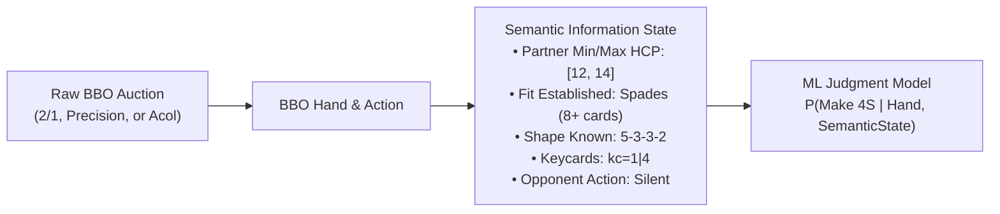
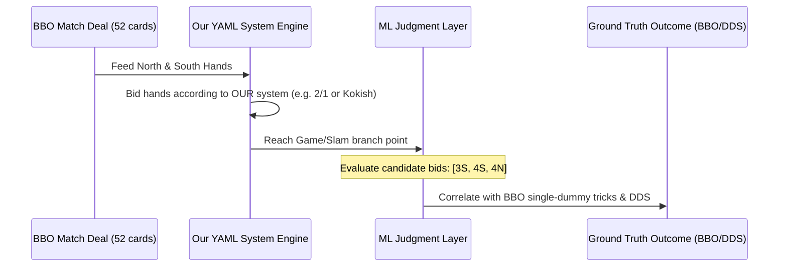
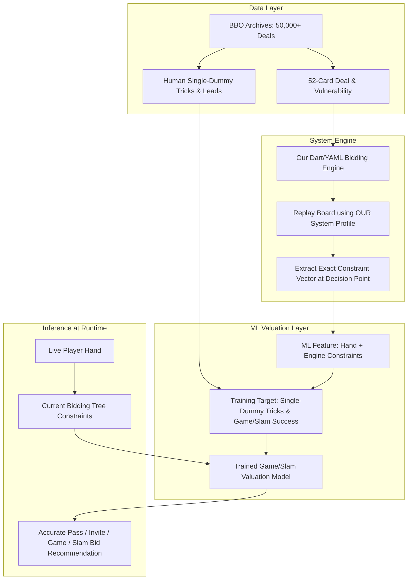

# Architecture Plan: Handling Diverse Bidding Systems in BBO Datasets for ML

## Goal Description
When using real-world human archives like Bridge Base Online (BBO Vugraph / Spingold) to train Machine Learning models for Game and Slam judgment, a major challenge is **system heterogeneity**:
* World-class partnerships play diverse bidding systems (e.g., standard 2/1 Game Force, Precision Club, Polish Club, Acol, Weak No-Trump, Kokish-Kraft, French SEF).
* A bid like `1NT` may mean 15–17 HCP for one pair, 14–16 for another, and 10–12 (weak) for a third.
* Artificial bids (transfers, relays, Gazilli, unusual overcalls) mean different things in different pairs.

If an ML model naively takes raw bid strings (`["1C", "1H", "2N"]`) as input, it will suffer from noisy, conflicting labels. This plan outlines four proven strategies and a recommended hybrid architecture to resolve system heterogeneity cleanly.

---

## The Four Solutions to System Heterogeneity

```
+---------------------------------------------------------------------------------------------------+
|                                  THE 4 METHODS COMPARISON                                         |
+--------------------------+-----------------------+------------------------+-----------------------+
| Method 1: Semantic State | Method 2: Engine      | Method 3: System       | Method 4: Decoupled   |
| (Belief Vector Mapping)  | Replay & Evaluation   | Fingerprint Filtering  | Single-Dummy Play     |
+--------------------------+-----------------------+------------------------+-----------------------+
| Map bids into mutual     | Feed BBO deals into   | Automatically tag      | Decouple auction from |
| knowledge: [HCP range,   | OUR yaml engine;      | pairs into system      | trick expectancy;     |
| suit lengths, fit].      | evaluate decisions    | families (e.g. 2/1);   | trick outcome depends |
| System-agnostic!         | at our own branches.  | filter training pool.  | on cards & leads.     |
+--------------------------+-----------------------+------------------------+-----------------------+
```

---

### Method 1: Semantic Belief Vector (Information State Representation)
Instead of feeding the ML model raw bid tokens (`"1H"`, `"2N"`), we map the bidding sequence into an **Abstract Semantic Information State**:



#### Why this works:
A decision to bid game or slam is ultimately a function of:
$$\text{Decision} = f\Big(\text{My Hand (13 cards)}, \text{Known Partner Constraints}, \text{Opponent Bidding Context}\Big)$$
Whether partner showed 12–14 balanced via a 1NT rebid in 2/1 or via a relay sequence in Precision, the *semantic constraint* on partner's hand is identical.

---

### Method 2: Engine Self-Replay (Counterfactual Simulation) — *Most Recommended for our Engine*
In this approach, we do **not** use the BBO human bidding sequence as the input to our engine. Instead, we use the **52-card deals** and the **actual single-dummy play outcomes**:



1. **Step 1**: Take the 52 cards of the BBO deal.
2. **Step 2**: Let **our system engine** (e.g. Gavin Wolpert 2/1 or Kokish Weak NT) bid the hand North-South.
3. **Step 3**: When our engine reaches a judgment junction (e.g., choice between inviting `3♠`, signing off `Pass`, or bidding game `4♠`), generate training samples:
   * **Feature**: My exact hand + Partner's accumulated constraints from our yaml rules.
   * **Label**: Did the 52-card deal actually produce 10 tricks in single-dummy human play / DDS?
4. **Benefit**: **100% system consistency.** Every training sample reflects the exact definitions and constraints of our own bidding system!

---

### Method 3: System Fingerprinting and Filtering
If we want to train directly on human bidding decisions, we filter the dataset so that only pairs playing the target system family are included.

#### Automatic Partnership Fingerprinter:
We classify partnerships into system buckets by inspecting their standard bids across the match:
* **1NT Opening Range**:
  $$\text{HCP}(1\text{NT}) \in [15, 17] \implies \text{Strong NT}; \quad \text{HCP}(1\text{NT}) \in [12, 14] \implies \text{Weak NT}$$
* **Major Openings**:
  $$\text{Length}(\text{Major}) \ge 5 \implies \text{5-Card Majors}; \quad \text{Length} = 4 \implies \text{4-Card Majors (Acol/SAYC 1960s)}$$
* **1♣ Opening**:
  $$\text{HCP}(1\text{♣}) \ge 16 \implies \text{Precision / Strong Club}; \quad \text{Natural} \implies \text{Standard 2/1 / Polish Club}$$

In tournaments like the Spingold (US National Championship), **over 80% of top pairs play 2/1 Game Force with 15–17 1NT and 5-card majors**. A lightweight filter easily isolates a clean, uniform 2/1 dataset.

---

### Method 4: Decoupled Single-Dummy Valuation Model
Notice that the laws of physics at the bridge table decouple bidding from play:
* Once you are in **4♠ by South with West leading**:
  * The number of tricks you make depends **only** on the 52 cards, the opening lead, and defensive play.
  * The cards do not know whether the auction was `1S - 2S - 4S` or `1C - 1S - 2S - 4S`!
* Therefore, the ML valuation model can be trained purely as an **Outcome Expectancy Function**:
  $$\mathbb{E}[\text{Tricks} \mid \text{North Hand}, \text{South Hand}, \text{Strain}, \text{Declarer}]$$
  calibrated against BBO single-dummy outcomes.
* During the auction, each player estimates this expected value by integrating over partner's constraint space:
  $$\mathbb{E}[\text{Score}] = \int_{\text{Partner} \in \mathcal{C}} \mathbb{E}[\text{Tricks} \mid \text{My Hand}, \text{Partner}, \text{Strain}] \cdot P(\text{Partner} \mid \text{Auction}) \, d\text{Partner}$$

---

## Recommended Hybrid Architecture

To get the best of all worlds without complex manual convention scraping:



### Why this Hybrid Solution is Ideal:
1. **Zero System Mismatch**: Because the auction is generated by *our* engine replay, the constraints (`kc`, `hcp`, shape) match our exact YAML definitions.
2. **Realistic Real-World Outcomes**: We use the actual human performance from the BBO archive (incorporating real opening leads, misguesses, and defensive discards).
3. **No Annotation Overhead**: You don't need to manually read convention cards for thousands of players.

---

## User Review Required

> [!IMPORTANT]
> **Key Architectural Decision**:
> We recommend **Method 2 (Engine Self-Replay on BBO Deals)**:
> * We feed the 52-card hands from the downloaded BBO datasets (e.g. Spingold, Bermuda Bowl) through our own system interpreter (`BiddingEngine`).
> * Our system bids the cards until it reaches a Game or Slam decision point.
> * We extract our engine's exact constraint state (`HandConstraint`), pairing it with the actual deal's outcome to train the ML model.
>
> This guarantees that the ML model is tailored 100% to **your** bidding conventions without any ambiguity from foreign systems.

---

## Proposed Implementation Plan

### Phase 1: BBO Deal Ingestion Pipeline
* Parse the downloaded `spingold_2025_dataset.json` (and additional tournaments) into clean 52-card deal representations `(Deal, Dealer, Vul, FinalContract, HumanTricks)`.

### Phase 2: System Replay Harness
* Implement a batch runner script (`tools/replay_bbo_deals.dart` or Python) that runs deals through our `BiddingEngine` with our current active profile (e.g., `kokish_kraft_weak_nt.yaml` or `gavin_wolpert_2_over_1.yaml`).
* Record the auction generated by our engine alongside the decision points (e.g., where a player holds a choice between Game/Slam bids).

### Phase 3: Dataset Generation for ML
* At each decision point, construct the feature vector:
  * Hand features (HCP, distribution, controls, honor locations).
  * Partner constraint features (min/max HCP, fit status, keycard count).
  * Vulnerability & strain.
* Label: Single-Dummy tricks made & double-dummy target achieved.

### Phase 4: Training & Model Integration
* Train a lightweight model (e.g., XGBoost / PyTorch MLP) to output:
  $$P(\text{Game makes}), \quad P(\text{Small Slam makes}), \quad P(\text{Grand Slam makes})$$
* Wire the model's predictions into our dynamic bid evaluators (`ActionDecisionProvider`).

---

## Verification Plan

### Automated Verification:
1. **Replay Engine Verification**:
   ```powershell
   dart run bin/replay_bbo_deals.dart --dataset res/spingold_2025/spingold_2025_dataset.json --limit 50
   ```
   Verify our engine parses the 52-card hands, conducts valid bidding sequences according to our rules, and records decision states.
2. **Feature Alignment Test**:
   Ensure generated feature vectors accurately capture `HandConstraint` bounds (e.g. HCP, suit lengths).
