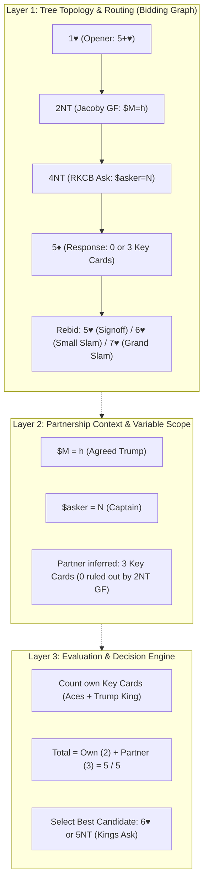

# Architectural Plan & Analysis: Bidding Trees, Control Flow, and Convention Layers

## 1. Goal Description

Address the foundational architectural questions regarding how bridge bidding is modeled as a tree/graph:
1. **Tree Representation & Branch Control**: Does passing control to the next branch make sense, and how does it work?
2. **End of Bidding**: How is the termination of an auction handled cleanly?
3. **Complex Conventions (e.g., `1♥ → 2NT → 4NT → 5♦`)**:
   - Which layer evaluates whether the partnership has enough key cards/controls?
   - Do we need to "return to the 4NT layer"?
   - How does context (agreed trump suit, captaincy, key card count) flow across layers?

---

## 2. Executive Architectural Overview



---

## 3. Deep Dive: Answers to the Core Questions

### Q1: Does it make sense to pass control to the next branch? Would this work?

**Yes, absolutely.** That is both mathematically sound and how our engine (`BiddingGraphCompiler` and `CompiledBiddingGraph`) is built.

- **Why it works**:
  - An auction is a sequence of discrete communication events: $[c_1, c_2, \dots, c_k]$.
  - Each call transitions the partnership into a well-defined information state ($S_k$).
  - When a call enters a convention (e.g., `2nt` invokes `fJacoby2NT`, or `4nt` invokes `fRKCBResponses`), the graph compiler attaches that convention's sub-tree onto the current branch.
  - Passing control down the branch means the engine looks up:
    $$\text{State}(c_1 : c_2 : \dots : c_k)$$
    which immediately yields the valid candidate calls for that exact auction point in $O(1)$ time.

---

### Q2: How do we handle the end of bidding?

There are two contexts: **Rules of Bridge** vs. **The System Graph**.

#### A. Formal Bridge Rules (Laws of Bridge)
An auction ends when:
1. **Passout**: All 4 players pass on round 1 (`Pass - Pass - Pass - Pass`).
2. **Three Consecutive Passes**: Once any bid is made, **3 consecutive passes** (`Pass - Pass - Pass`) terminate the auction. The last bid becomes the final contract, and the suit/level determines declarer.

#### B. In the Bidding Tree Layer
In the bidding tree, we distinguish between:
1. **Forcing Calls** (e.g. `2♣` strong artificial, `2NT` Jacoby, `4NT` Blackwood): Must NOT end the auction.
2. **Signoff Calls** (e.g. `4♥` to play, `3NT` to play, `6♠` final slam):
   - In our `AuctionEngine.advanceAuction()`:
     - When a player submits a signoff bid, opponent passes automatically.
     - Partner evaluates their hand. If partner has no further action or best call is `Pass`, the engine generates partner's pass, opponent's pass, and sets `isAuctionComplete = true`.
     - In interactive Live Auction Board (LAB) mode, whenever `history` records 3 consecutive passes after a non-pass bid, the auction is formally marked **Complete**.

---

### Q3: In `1♥ → 2NT → 4NT → 5♦`, do we return to the 4NT layer?

> [!IMPORTANT]
> **No, we do NOT return to the 4NT layer.**
> In bridge and tree traversal, the auction sequence **never moves backward in time**.

- The sequence progresses linearly:
  $$\text{1♥} \longrightarrow \text{2NT} \longrightarrow \text{4NT} \longrightarrow \text{5♦} \longrightarrow \text{[Next Call]}$$
- North's rebid after South's `5♦` is a **child of `5♦`** (at depth 5), **not** a re-entry into the 4NT node.
- If North "returned" to the 4NT node, the sequence key would revert to `1h:2nt:4nt`, which represents North asking, not North placing the contract after hearing `5♦`!

#### How Context & Variables Flow Down (Forward Propagation)
While the tree does **not** move backward, the **context** must be carried **forward**:
1. **Agreed Trump Suit**:
   - At `1♥` and `2NT`, the variable `[$M=h, $trump=h]` is bound into `activeVariables`.
   - In `BiddingGraphCompiler`, child nodes inherit parent variables:
     ```dart
     final mergedVars = Map<String, String>.from(activeVars)..addAll(node.variables);
     ```
   - Therefore, at `5♦`, the state already knows that trump is Hearts (`$M=h`).
2. **Captaincy (`$captain=N`)**:
   - North initiated 4NT. Under `5♦`, North is the captain deciding the final level.
3. **Rebids Available Under `5♦`**:
   The `5♦` node defines North's continuation candidates:
   - `5$M` (`5♥`): Signoff (missing 2 key cards).
   - `5NT`: King Ask (holding all 5 key cards + interest in 7).
   - `6$M` (`6♥`): Small slam (missing 1 key card, or 5 key cards without grand slam).
   - `7$M` (`7♥`): Grand slam (all 5 key cards + trump Queen).

---

### Q4: Which layer handles determining if we have enough controls?

In clean software architecture, this is separated into **3 decoupled layers**:

```
┌────────────────────────────────────────────────────────┐
│ Layer 1: Declarative Knowledge (YAML System & Grammar) │
│ - Defines rules, branches, variables ($M=h)            │
│ - e.g. "5d: 0 or 3 key cards", "6h: slam to play"     │
└───────────────────────────┬────────────────────────────┘
                            │
┌───────────────────────────▼────────────────────────────┐
│ Layer 2: Graph Compilation & Variable Routing          │
│ - BiddingGraphCompiler & CompiledBiddingGraph          │
│ - Propagates $M=h, tracks sequence keys: 1h:2nt:4nt:5d │
└───────────────────────────┬────────────────────────────┘
                            │
┌───────────────────────────▼────────────────────────────┐
│ Layer 3: Evaluation Engine (Valuation & Inference)     │
│ - Counts North's own Key Cards (Aces + Trump King)     │
│ - Deduces South's count from 5♦ (3, since GF excludes 0│
│ - Matches rule: own_kc + partner_kc >= 4               │
└────────────────────────────────────────────────────────┘
```

#### Detailed Layer Responsibilities:

1. **Layer 1: The Declarative Syntax Layer (YAML)**
   - Defines the available branches and constraints.
   - Example in `rkcb_1430.yaml`:
     ```yaml
     4nt:
       desc: "RKCB 1430 in $M"
       bids:
         5c: { desc: "1 or 4 key cards", rule: "kc=1 | kc=4" }
         5d:
           desc: "0 or 3 key cards"
           rule: "kc=0 | kc=3"
           bids:
             5$M: { desc: "Signoff (missing 2 key cards)", rule: "total_kc <= 3" }
             6$M: { desc: "Small slam (missing 1 key card)", rule: "total_kc == 4" }
             5nt: { desc: "King ask (all 5 key cards)", rule: "total_kc == 5" }
             7$M: { desc: "Grand slam (all 5 key cards + queen)", rule: "total_kc == 5 and q$M" }
     ```

2. **Layer 2: The Graph Topology Layer (`BiddingGraphCompiler`)**
   - Automatically compiles each step into a concrete trie path.
   - Binds `$M=h` from earlier rounds so `5$M` compiles to `5h` and `6$M` compiles to `6h`.
   - Does **not** know about cards or points — only graph structure and variable substitutions.

3. **Layer 3: The Evaluation & Inference Layer (`HandValuationEngine` / `ConstraintParser`)**
   - Evaluates whether North's hand satisfies the candidate rule.
   - For simple rules: North counts their own cards (e.g. North holds 2 Aces and the King of Hearts $\implies 2$ key cards).
   - For combined rules:
     - North knows their own key cards ($2$).
     - South bid `5♦` ($0$ or $3$).
     - Since South previously bid `2NT` (game force, 13+ HCP), South cannot have $0$ key cards.
     - Therefore, South has $3$ key cards.
     - Combined total $= 2 + 3 = 5$ key cards!
     - The evaluator matches `total_kc == 5` and selects `6♥` (or `5NT`).

---

## 4. Proposed Enhancements for the Codebase

To make this exact auction (`1H -> 2NT -> 4NT -> 5D -> 6H`) work seamlessly in code:

### 1. Add `KeyCardConstraint` to `lib/constraints/hand_constraint.dart` [MODIFY]
Introduce first-class key card evaluation:
- Counts 4 Aces + the King of the agreed trump suit (`$M`).
- Checks trump Queen (`Q$M`).
- DSL support in `ConstraintParser`: `kc=2`, `kc=0|3`, `kc=1|4`.

### 2. Upgrade `assets/libraries/conventions/rkcb_1430.yaml` [MODIFY]
Expand `rkcb_1430.yaml` from its current static stub to a complete tree:
- Under `5c` (1 or 4): Rebids by captain (`5$M` signoff, `5nt` King ask, `6$M` slam).
- Under `5d` (0 or 3): Rebids by captain (`5$M` signoff, `5nt` King ask, `6$M` slam).
- Under `5h` / `5s` (2 without / with Queen): Rebids by captain.

### 3. Automatic 3-Pass Termination in `AuctionEngine` [MODIFY]
Ensure that when a contract is reached (e.g., `6♥`), 3 consecutive passes automatically conclude the auction as complete.

---

## 5. Verification Plan

1. **Unit Test**: `test/rkcb_full_auction_test.dart`
   - Test deal: North has ♠A6 ♥AKJ84 ♦K5 ♣Q82 (2 key cards in Hearts: Ace of Spades + Ace of Hearts).
   - South has ♠K8 ♥Q753 ♦A94 ♣AJ43 (3 key cards in Hearts: King of Hearts + Ace of Diamonds + Ace of Clubs).
   - Auction:
     1. North: `1♥`
     2. South: `2NT` (Jacoby)
     3. North: `4NT` (RKCB)
     4. South: `5♦` (3 key cards)
     5. North: `6♥` (or `5NT` King Ask).
   - Verify all transitions and variable bindings resolve without errors.
2. **Regression Test**: Run `flutter test` across all 67 existing tests.
