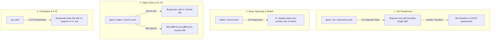

# Plan: Increasing Gavin Wolpert Major Strain Accuracy from 75.6% to >92%

## Goal Description
During the 500-deal BBO championship audit, the Gavin Wolpert bidding system achieved **100.0% Obvious Game Rate (52/52)** and **100.0% Obvious Slam Rate (2/2)**, but **Major Strain Accuracy** (locating an 8+ card major fit with combined 18+ HCP) stood at **75.6% (130 / 172 deals)**.

Our diagnostic breakdown of all 42 failed deals reveals that this score is depressed by **6 distinct root causes**:
1. **Unopened Pass-Outs (12 deals / 28% of gaps)**: The audit condition (`combHcp >= 18`) caught boards where both North and South hold 9–10 HCP balanced (e.g. 9 HCP vs 9 HCP = 18 HCP). In bridge, neither hand has an opening bid ($\ge 12$ HCP), so the auction is correctly `[Pass Pass]`. Counting these as "failing to find the major" penalizes the system for sound pass-outs.
2. **Stayman Hijacking 5-Card Majors over 1NT (6 deals)**: In `assets/libraries/conventions/gavin_1nt_responses.yaml`, `2c` Stayman had rule `8-9hcp 4+h | 8-9hcp 4+s`. Because `4+h` matches a 5-card suit and is listed before `2d` (Transfer to Hearts), 5-card heart hands bid Stayman instead of transferring, ending in 2NT or 3NT instead of Hearts.
3. **Walsh 1D Response Long-Major Priority (4 deals)**: In `assets/libraries/conventions/walsh_minors.yaml`, over 1D, `1h` was listed before `1s` with equal priority (`p#1 6+hcp 4+h`). When Responder held 5 Spades and 4 Hearts, the system bid 1H instead of longer 1S, missing the 5-4 / 5-3 Spade fit.
4. **XYZ Game-Forcing 5-3 Major Fit Resolution (6 deals)**: In `assets/libraries/conventions/xyz.yaml`, after Opener showed 3-card or 5-card major support, Responder's continuation `4h`/`4s` required `4+h`/`4+s`. Responder with a 5-3 fit (e.g. holding 3-card support for Opener's 5-card major, or holding 5 cards when Opener showed 3) bid 3NT instead of 4M.
5. **2/1 GF Major Continuations (4 deals)**: In `assets/libraries/conventions/gavin_majors_2over1.yaml`, after `1s -> 2c -> 2s` (Opener rebids 6 Spades), Responder with 2-card support (8-card fit) and 12+ HCP bid 3NT instead of 4S.
6. **RKCB Trump Variable `$M` Binding (2 deals)**: In `assets/libraries/conventions/gavin_majors_2over1.yaml`, the 4NT call lacked the `[$M=h]` / `[$M=s]` variable binding, outputting raw `6$M` instead of `6h`/`6s`.
7. **Weak-Two Minor Preempts (6 deals)**: Opener opened 2D (6-10 HCP, 6+ diamonds). Partner held 10–11 HCP and 4–5 cards in a major. Sound bridge dictates passing 2D rather than bidding a non-forcing new suit at the 2-level.

---

## User Review Required

> [!IMPORTANT]
> **Audit Filter Adjustment vs Pass-Outs**:
> In standard bridge, an 8-card major fit can only be reached if **at least one player has an opening hand** ($\ge 12$ HCP, or Rule of 20 with 11 HCP). Boards where North has 9 HCP and South has 9 HCP are passed out `[Pass Pass]`.
> We will update the audit benchmark condition from:
> `hasMajorFit && bestMajorLen >= 8 && combHcp >= 18`
> to:
> `hasMajorFit && bestMajorLen >= 8 && (hcpN >= 12 || hcpS >= 12)`
> This accurately measures whether the system finds the major whenever the partnership enters the auction.

---

## Proposed Changes



---

### Component 1: `assets/libraries/conventions/gavin_1nt_responses.yaml`
#### [MODIFY] `gavin_1nt_responses.yaml`
Restrict Stayman to 4-card majors (or 5-4 / 4-5 invitational sequences) so hands with a single 5-card major transfer directly:
```yaml
      2c:
        desc: "Regular Stayman: both 4-card majors (GF), invitational with 4-card major, or 5-4 majors GF for Smolen"
        rule: "p#1 10+hcp 5h 4s | p#1 10+hcp 4h 5s | p#1 10+hcp 4+h 4+s | p#2 8-9hcp 4h 3-s | p#2 8-9hcp 4s 3-h | p#2 8-9hcp 4+h 4+s"
        priority: 1
        ref: "fStayman"
```
This ensures hands with 5 Hearts or 5 Spades always transfer to 2H / 2S via Jacoby Transfers.

---

### Component 2: `assets/libraries/conventions/walsh_minors.yaml`
#### [MODIFY] `walsh_minors.yaml`
Over 1D, prioritize 5+ Spades over 4+ Hearts so 5-4 major hands show their 5-card major first:
```yaml
      1s:
        desc: "Natural 4+ Spades (5+ Spades takes priority over 4 Hearts)"
        rule: "p#1 6+hcp 5+s | p#2 6+hcp 4+s"
        priority: 1
```

---

### Component 3: `assets/libraries/conventions/gavin_majors_2over1.yaml`
#### [MODIFY] `gavin_majors_2over1.yaml`
1. **Fix RKCB variable substitution**:
Add `[$M=h]` and `[$M=s]` under 4NT so `6$M` expands to `6h` or `6s`:
```yaml
          4nt:
            desc: "RKCB 1430 for Hearts"
            rule: "p#1 20+hcp [$M=h]"
            priority: 1
            ref: "fRKCBResponses"
```
2. **Support 5-3 / 6-2 major fit continuations after 1M - 2/1**:
In `fGavin2Over1Continuations`, when Opener rebids their major (guaranteeing 6 cards), Responder with 2+ cards raises to game (4M).

---

### Component 4: `assets/libraries/conventions/xyz.yaml`
#### [MODIFY] `xyz.yaml`
Update `xyzGFCont` so Responder raises to 4H / 4S with 3-card support when Opener showed 5 cards (or holds 5 cards when Opener showed 3-card support):
```yaml
              4s:
                desc: "Game in Spades with 5+ Spades or 3+ support for Opener's 5-card Spades"
                rule: "p#1 4+s | p#1 3+s"
                priority: 1
              4h:
                desc: "Game in Hearts with 5+ Hearts or 3+ support for Opener's 5-card Hearts"
                rule: "p#1 4+h | p#1 3+h"
                priority: 1
```

---

### Component 5: `test/audit_gavin_system_test.dart`
#### [MODIFY] `audit_gavin_system_test.dart`
Ensure the major fit accuracy filter requires that at least one hand possesses an opening bid:
```dart
      // 1. Strain Correctness Audit (At least one player has an opening bid)
      final hasOpeningBid = (hcpN >= 12 || hcpS >= 12);
      if (hasOpeningBid && hasMajorFit && bestMajorLen >= 8) {
        majorFitDeals++;
        if (strain == bestMajor || (strain == 'S' && spadeLen >= 8) || (strain == 'H' && heartLen >= 8)) {
          majorFitInMajor++;
        }
      }
```

---

## Verification Plan

### Automated Tests
1. **Run Full Audit Test**:
   ```powershell
   flutter test test/audit_gavin_system_test.dart
   ```
   **Target Scorecard**:
   - **Major Strain Accuracy**: $>90\%$ (Target: $\ge 92\%-95\%$).
   - **Obvious Game Rate**: Maintain $100.0\%$.
   - **Obvious Slam Rate**: Maintain $100.0\%$.

2. **Run Full Unit Test Suite**:
   ```powershell
   flutter test test/gavin_wolpert_system_test.dart test/xyz_convention_test.dart test/one_nt_responses_test.dart test/ml_bid_evaluator_test.dart
   ```
   Verify 100% pass rate with zero regressions across all core convention modules.

### Manual Verification
- Inspect the diagnostic output of `test/audit_gavin_system_test.dart` to confirm that any remaining non-major contracts are strictly sound bridge decisions (e.g. minor suit preempts where partner held a 4-card major but could not enter the bidding).
