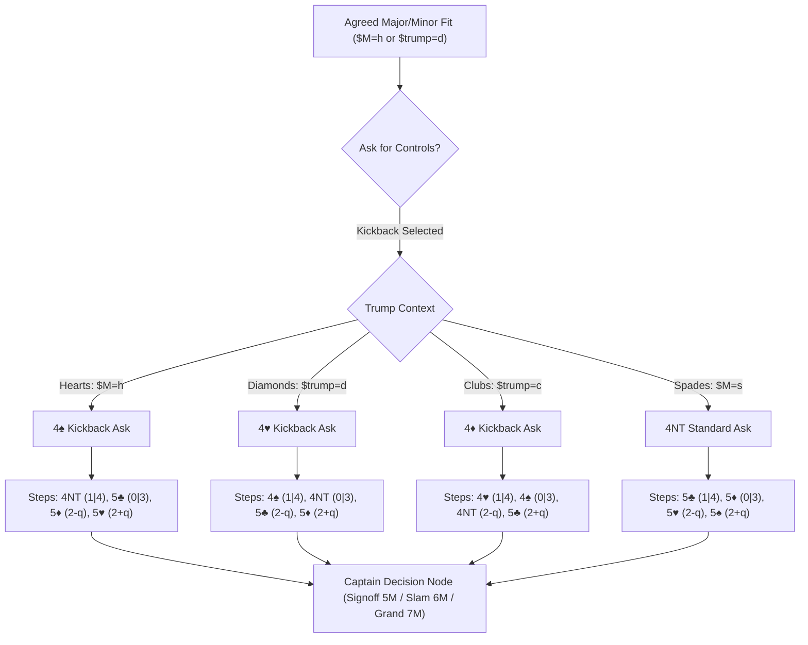

# Bidding Fragment Layering & Kickback RKCB Architecture Plan

## 1. Goal Description

This plan addresses two fundamental questions in bridge bidding system engineering:
1. **Fragment Layering**: Should fragments contain only one layer (ply) of bids and pass control forward via `ref:`, or should they encapsulate multi-ply conversational phases?
2. **Kickback RKCB (One-Over Keycard)**: When the trump suit determines both the keycard ask call and the subsequent step ladder (e.g. 4♦ for Clubs, 4♥ for Diamonds, 4♠ for Hearts, 4NT for Spades), how do fragments and variable propagation cleanly coordinate this in the bidding graph?

---

## 2. Executive Answers to User Questions

### Q1: Should there just be one layer of bids and pass on to the next fragments?

> [!TIP]
> **Recommendation: The "Semantic Phase" Model (1 to 2 plies per fragment)**
> A fragment should represent a **complete, coherent conversational exchange** rather than strictly a single ply or an endless monolith.

- **Strict Single-Ply (1-Layer Only)**:
  - If *every single bid* delegates to a new fragment:
    `fJacoby2NT` $\to$ `ref: fJacoby2NT_OpenerRebids` $\to$ `ref: fJacoby2NT_ResponderAfter3C` $\to$ `ref: fRKCB_Ask` $\to$ `ref: fRKCB_Step2` $\to$ `ref: fRKCB_CaptainAfterStep2`.
  - **Downside**: Fragment proliferation explodes (dozens of tiny 3-line fragments), making the system harder to trace and maintain.
- **The Ideal Balance (Semantic Phase)**:
  - **Phase 1: Structure Entry**: e.g. `fJacoby2NT` handles Opener's description rebids (`3c`, `3d`, `3h`, `3s`, `3nt`, `4nt`).
  - **Phase 2: Hand-Off to Convention Subsystem**: Opener's `4nt` (or `4s` Kickback) delegates via `ref: fRKCB1430` or `ref: fKickback`.
  - **Phase 3: Convention Resolution**: The convention fragment contains the **Step Responses** and their **Immediate Decision Closures** (Signoff in 5M, Queen ask, King ask, Small Slam 6M, Grand Slam 7M). Once slam is bid or signed off, the contract is placed and the auction ends.

---

### Q2: How would we handle something like Kickback?

In standard RKCB, 4NT is always the keycard ask. But when the agreed trump suit is a minor or Hearts, standard 4NT can be dangerous because responder's step response can push the partnership past the safe 5-level signoff!

**Kickback** solves this by using the bid **one step above the 4-level agreed trump suit**:

| Agreed Trump Suit | Kickback Key Card Ask | Step 1 (1 or 4) | Step 2 (0 or 3) | Step 3 (2 no Q) | Step 4 (2 with Q) | Safe Signoff |
| :--- | :--- | :--- | :--- | :--- | :--- | :--- |
| **♣ Clubs** | **4♦** | 4♥ | 4♠ | 4NT | 5♣ | **5♣** |
| **♦ Diamonds** | **4♥** | 4♠ | 4NT | 5♣ | 5♦ | **5♦** |
| **♥ Hearts** | **4♠** | 4NT | 5♣ | 5♦ | 5♥ | **5♥** |
| **♠ Spades** | **4NT** | 5♣ | 5♦ | 5♥ | 5♠ | **5♠** |

Notice that in every case, **all four step responses are at or below game in the agreed trump suit**, guaranteeing that the captain can sign off in 5-of-trump if missing two key cards!

---

## 3. Kickback Architecture & Control Flow



### Three Design Approaches for Kickback Fragments

#### Approach A: Dedicated Suit Fragments (Recommended & Existing in Codebase)
As already started in [`serious_3nt_and_kickback.yaml`](file:///c:/Users/johnh/Documents/josulasa/bridge_doc/assets/libraries/conventions/serious_3nt_and_kickback.yaml):
- `fKickbackClubs`: `4d` ask $\to$ `4h`, `4s`, `4nt`, `5c`
- `fKickbackDiamonds`: `4h` ask $\to$ `4s`, `4nt`, `5c`, `5d`
- `fKickbackHearts`: `4s` ask $\to$ `4nt`, `5c`, `5d`, `5h`
- `fRKCB1430` / `fKickbackSpades`: `4nt` ask $\to$ `5c`, `5d`, `5h`, `5s`

**Umbrella Router Fragment `fKickbackAsk`**:
```yaml
fragments:
  fKickbackAsk:
    desc: "Kickback RKCB Ask (One Over Keycard) based on agreed trump"
    bids:
      "<$M=h> 4s":
        desc: "Kickback: 1430 RKCB for Hearts"
        rule: "p#1 14+hcp"
        priority: 1
        ref: "fKickbackHearts"
      "<$M=s> 4nt":
        desc: "1430 RKCB for Spades"
        rule: "p#1 14+hcp"
        priority: 1
        ref: "fRKCB1430"
      "<$trump=d> 4h":
        desc: "Kickback: 1430 RKCB for Diamonds"
        rule: "p#1 14+hcp"
        priority: 1
        ref: "fKickbackDiamonds"
      "<$trump=c> 4d":
        desc: "Kickback: 1430 RKCB for Clubs"
        rule: "p#1 14+hcp"
        priority: 1
        ref: "fKickbackClubs"
```

> [!NOTE]
> When any bidding sequence (Jacoby 2NT, 2/1 in Diamonds, Serious 3NT) reaches slam bidding, it simply specifies `ref: "fKickbackAsk"`. Because `$M` or `$trump` is already bound in `activeVariables`, only the exact matching Kickback call is made available!

#### Approach B: Step Ladder Fragment with Relative Offsets (Advanced Dynamic Option)
Instead of 4 fragments, the engine could resolve dynamic relative calls:
- Ask: `+1 step above 4$trump`
- Step 1: `+1 step above ask` (`kc=1|4 $trump`)
- Step 2: `+2 steps above ask` (`kc=0|3 $trump`)
- Step 3: `+3 steps above ask` (`kc=2-q $trump`)
- Step 4: `+4 steps above ask` (`kc=2+q $trump`)

**Trade-off**: Approach A is immediately expressible in pure declarative YAML without needing compiler syntax modifications, while Approach B requires custom dynamic parser step arithmetic. **Approach A is far more transparent and immediately functional.**

---

## 4. User Review Required

> [!IMPORTANT]
> **Key Design Decision for Your Feedback**:
> 1. Do you prefer **Approach A (Declarative Suit-Specific Kickback Fragments with an Umbrella `fKickbackAsk` Router)**, which matches the existing structure in `serious_3nt_and_kickback.yaml`?
> 2. Should standard 1430 4NT remain an option, or should Kickback 4♠ over Hearts be the system default when Gavin Wolpert / US 2/1 slam methods are configured?

---

## 5. Proposed Changes

### Component 1: Convention Libraries

#### [MODIFY] [`assets/libraries/conventions/serious_3nt_and_kickback.yaml`](file:///c:/Users/johnh/Documents/josulasa/bridge_doc/assets/libraries/conventions/serious_3nt_and_kickback.yaml)
- Add **`fKickbackHearts`**:
  - `4s` Kickback ask.
  - Step responses: `4nt` (1|4), `5c` (0|3), `5d` (2-q), `5h` (2+q).
  - Captain rebids under each step: `5h` (signoff), `5s` (Queen ask / King ask), `6h` (slam), `7h` (grand slam).
- Add umbrella router **`fKickbackAsk`** routing conditionally via `<$M=h>`, `<$M=s>`, `<$trump=d>`, `<$trump=c>`.
- Expand **`fKickbackDiamonds`** and **`fKickbackClubs`** with complete `KeyCardConstraint` rules (`kc=1|4`, `kc=0|3`, `kc=2-q`, `kc=2+q`) and captain rebids.

#### [MODIFY] [`assets/libraries/conventions/jacoby_2nt.yaml`](file:///c:/Users/johnh/Documents/josulasa/bridge_doc/assets/libraries/conventions/jacoby_2nt.yaml)
- Add Kickback alternatives:
  - `<$M=h> 4s`: "Kickback RKCB for Hearts" referencing `fKickbackHearts`.
  - `<$M=s> 4nt`: "1430 RKCB for Spades" referencing `fRKCB1430`.

### Component 2: System Profiles

#### [MODIFY] [`assets/core/systems/gavin_wolpert_2over1.yaml`](file:///c:/Users/johnh/Documents/josulasa/bridge_doc/assets/core/systems/gavin_wolpert_2over1.yaml)
- Import `serious_3nt_and_kickback.yaml`.
- Expose `fKickbackAsk` in slam auctions.

### Component 3: Test Verification Suite

#### [NEW] `test/kickback_rkcb_test.dart`
- Verify Kickback for Hearts (`1H -> 2NT -> 4S -> 5C -> 6H`).
- Verify Kickback for Diamonds (`1D -> 2D/3D -> 4H -> 4NT -> 6D`).
- Verify Kickback for Clubs (`1C -> 2C/3C -> 4D -> 4S -> 6C`).
- Verify safe signoff at 5-level when missing 2 key cards (e.g. `1H -> 2NT -> 4S -> 4NT (1 keycard) -> 5H signoff`).

---

## 6. Verification Plan

### Automated Tests
Run targeted and full test suites:
```powershell
flutter test test/kickback_rkcb_test.dart
flutter test
```
**Success Criteria**:
- All existing 76 tests remain 100% green.
- New Kickback auction tests resolve accurately with 0 regressions.
