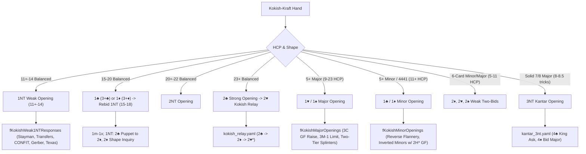

# Kokish-Kraft Weak No-Trump System (Jan 2008) Architecture & Representation Plan

## 1. Goal Description

This plan analyzes the comprehensive 383-page system document **`res/WEAK-NOTRUMP-SYSTEM-Kokish-Kraft-Jan-2008.pdf`** by Eric Kokish & Beverly Kraft (January 2008), outlines how to represent it in the bridge system YAML architecture, identifies what existing conventions can be **reused without change or with minimal change**, and specifies what **new modules and YAML files** are required.

---

## 2. Core Philosophy & System Architecture

The Kokish-Kraft system is a tournament-caliber **Modified Kaplan-Sheinwold** framework featuring:
1. **Weak No-Trump Opening (11+-14 HCP)** in 1st, 2nd, and 3rd/4th seats with a specialized response structure, escape mechanisms against penalty doubles, and distinct competitive continuations.
2. **Sound 5-Card Majors (9-23 HCP)**: With 11+-14 balanced, opener opens 1NT, **never 1M**. Consequently, 1M openings guarantee an unbalanced hand or 15+ HCP, eliminating awkward rebids.
3. **Minor-Suit Openings (1♣ & 1♦)**: 15-20 HCP if balanced, 11+ with 5+m, or 12+ with 4=4=1=4 / 4=4=4=1 patterns.
4. **Strong 1NT Rebid (15 to bad 18 HCP)**: Since 11+-14 balanced opened 1NT, opener's 1NT rebid after 1m-1x always shows 15-18 HCP and uses a 2♣ puppet to 2♦ / 2♦ artificial GF inquiry structure.
5. **2/1 Game Forcing**: Pure game force after major openings.
6. **2♣ Strong Artificial Opening**: 23+ balanced or GF unbalanced, using **step control responses** (2♦=0-1, 2♥=2, 2♠=3+) and the famous **Kokish Relay** (`2♣ -> 2♦ -> 2♥*`).
7. **2NT Family Structure (20+-22 HCP)**: Includes 2NT openings and Kokish 2♣ rebids, with Texas transfers, CONFIT/SUPERCONFIT slam tries, and Walsh transfers.
8. **Slam Machinery**: RKCB 1430, Kickback RKCB for all 4 suits, Exclusion RKCB (0314), 6RKCB (double agreement situations), and Kantar 3NT.

---

## 3. Reusability Analysis: Existing Modules

Our codebase already contains modular convention libraries. Here is the exact audit of what can be reused:

### A. Reusable 100% Without Change
1. **[`assets/libraries/conventions/kokish_relay.yaml`](file:///c:/Users/johnh/Documents/josulasa/bridge_doc/assets/libraries/conventions/kokish_relay.yaml)**:
   - Implements Eric Kokish's exact `2♣ -> 2♦ -> 2♥*` relay sequence (showing either natural Hearts or 24+ balanced, puppet to 2♠).
2. **[`assets/libraries/conventions/rkcb_1430.yaml`](file:///c:/Users/johnh/Documents/josulasa/bridge_doc/assets/libraries/conventions/rkcb_1430.yaml)**:
   - Full 1430 step responses (`5♣`=1|4, `5♦`=0|3, `5♥`=2-q, `5♠`=2+q) and captain rebids.
3. **[`assets/libraries/conventions/serious_3nt_and_kickback.yaml`](file:///c:/Users/johnh/Documents/josulasa/bridge_doc/assets/libraries/conventions/serious_3nt_and_kickback.yaml)**:
   - Serious 3NT and Kickback for all 4 suits: 4♠ for Hearts, 4♥ for Diamonds, 4♦ for Clubs, 4NT for Spades.
4. **[`assets/libraries/conventions/smolen.yaml`](file:///c:/Users/johnh/Documents/josulasa/bridge_doc/assets/libraries/conventions/smolen.yaml)**:
   - Smolen transfers after Stayman (`3♥*` = 5♠/4♥, `3♠*` = 5♥/4♠).
5. **[`assets/libraries/conventions/puppet_stayman.yaml`](file:///c:/Users/johnh/Documents/josulasa/bridge_doc/assets/libraries/conventions/puppet_stayman.yaml)**:
   - 3♣ Puppet Stayman over 2NT.
6. **[`assets/libraries/conventions/two_way_checkback.yaml`](file:///c:/Users/johnh/Documents/josulasa/bridge_doc/assets/libraries/conventions/two_way_checkback.yaml)** & **[`assets/libraries/conventions/xyz.yaml`](file:///c:/Users/johnh/Documents/josulasa/bridge_doc/assets/libraries/conventions/xyz.yaml)**:
   - 2♣ puppet / 2♦ GF checkback structure.
7. **[`assets/libraries/conventions/drury.yaml`](file:///c:/Users/johnh/Documents/josulasa/bridge_doc/assets/libraries/conventions/drury.yaml)**:
   - Drury-Fit by passed hand over 1M openings (p. 133 of PDF).
8. **[`assets/libraries/conventions/preempt_responses.yaml`](file:///c:/Users/johnh/Documents/josulasa/bridge_doc/assets/libraries/conventions/preempt_responses.yaml)**:
   - 3-level and 4-level preemptive continuations.

### B. Reusable With Minimal Change / Parameterization
1. **`stayman.yaml` & `jacoby_transfers.yaml`**:
   - Reused under 1NT, but Kokish adds minor-suit transfers (`2♠` for Clubs, `2NT` for Diamonds) and Walsh 3-suiter relay over `2♦`.
2. **`weak_two_responses.yaml`**:
   - Reused for 2♦/2♥/2♠ weak two-bids, but Kokish adds an artificial 3♣ shortness inquiry alongside the 2NT feature ask (p. 211, 215, 219).

---

## 4. What Is New (Components to Implement)

To faithfully model the Kokish-Kraft system, the following **6 new YAML modules** and **1 system master file** are required:

### 1. [NEW] `assets/libraries/conventions/kokish_weak_1nt.yaml`
- **Range**: 11+-14 HCP balanced.
- **Direct Responses**:
  - `2♣`: Non-forcing Stayman (promises 4M or 5M; opener bids Hearts first with 4-4).
  - `2♦*`: Jacoby Transfer to Hearts (also Walsh for 3-suiters, 5+♣/5+♦ FG, or Superconfit).
  - `2♥*`: Jacoby Transfer to Spades (with 2NT next = 4+♣ FG, 3♣ = 4+♦ FG).
  - `2♠*`: Transfer to Clubs OR balanced raise to 2NT (opener bids 2NT min, 3♣ max).
  - `2NT*`: Transfer to Diamonds OR weak 5+♣/5+♦ (opener bids 3♦ max, 3♣ min).
  - `3♣`: 5+♣/5+♦ Invitational.
  - `3♦*`: CONFIT (balanced slam try, asks controls 3+).
  - `3♥* / 3♠*`: Splinters (shortness in H/S, 5-4 minors, FG).
  - `3NT`: Natural to play (limited 4M333).
  - `4♣`: Gerber (0/4, 1, 2, 3 aces).
  - `4♦* / 4♥*`: Texas Transfers to 4♥ / 4♠.
  - `4♠ / 4NT`: Quantitative raises with 6♣ / 6♦ to 3/5 top honors.

### 2. [NEW] `assets/libraries/conventions/kokish_1nt_escape.yaml`
- **Runout Structure over 1NT - (DBL)** (p. 145–147 of PDF):
  - Used when 2nd hand doubles for Penalty or unspecified one-suiter:
    - `Pass`: Forces Redouble (one-suiter, 4441, or 8+).
    - `Redouble`: Two-suiter: ♦+♣ or ♦+♠.
    - `2♣*`: ♣+♥.
    - `2♦*`: ♦+♥.
    - `2♥*`: ♠+♥.
    - `2♠*`: ♠+♣.
    - `2NT*`: Weak with Clubs or strong without Clubs.
    - `3♣*`: Weak with Diamonds or strong without Diamonds.
    - `3♦*`: Weak with Hearts or strong three-suiter.

### 3. [NEW] `assets/libraries/conventions/kokish_minor_openings.yaml`
- **1♣ Opening**: 15-20 bal, 11+ with 5+♣, 12+ with 4=4=1=4 / 4=4=4=1.
- **1♦ Opening**: 15-20 bal, 11+ with 5+♦, 12+ with 4=1=4=4 / 4=4=4=1.
- **Responses & Continuations**:
  - `1♣ - 1♦`: May be short/waiting (no 4-card major, unsuitable for 2♣ raise, prefers 1NT from opener).
  - **Reverse Flannery** (p. 51):
    - Over 1♣: `2♦*` = 5+♠/4+♥ weak (4-7 HCP), `2♥*` = 5+♠/4+♥ INV (7-11), `2♠*` = 6+♠/4♥ INV.
    - Over 1♦: `2♥*` = 5+♠/4+♥ weak-to-INV (3-10 HCP), `2♠*` = 6+♠/4♥ INV.
  - **Inverted Minors with 2♥* FG Rebid** (p. 36):
    - `1m - 2m`: 4+m, limit raise or better (forcing to 3m).
    - Opener's `2♥*`: Artificial game force with 4+ in agreed minor.
    - Opener's `1st non-2H bid` (2♦ or 2♠): Unbalanced game try.
  - **Strong 1NT Rebid Structure (15 to bad 18 HCP)** (p. 17–27):
    - `1m - 1x; 1NT - 2♣*`: Puppet to 2♦ (signoffs and invitational hands).
    - `1m - 1x; 1NT - 2♦*`: Artificial Game-Forcing shape inquiry.

### 4. [NEW] `assets/libraries/conventions/kokish_major_openings.yaml`
- **1♥ / 1♠ Openings**: 5+ cards, 9-23 HCP, denying 11+-14 balanced.
- **Raises & Responses** (p. 71–84):
  - `2M`: Semi-constructive raise (3+ trumps, 4-11 HCP).
  - `1M - 1NT`: Semi-forcing (0-12 HCP).
  - `1M - 3♣*`: Artificial Game-Forcing Raise (13-16 HCP balanced).
  - `1M - 3M-1*` (3♦ over 1♥, 3♥ over 1♠): Artificial 4-trump Limit Raise.
  - `1M - 3M`: Preemptive raise.
  - `1M - 3M+1*` (3♠ over 1♥, 3NT over 1♠): Strong unknown Splinter (12+-15 HCP).
  - `1M - 4m/4OM`: Light Splinters (9-12 HCP).
  - `1♥ - 2♠*`: Special game-forcing raise (5+♠/3♥, FG).
  - `1♠ - 3♦*`: Dual weak / strong jump shift in Hearts.

### 5. [NEW] `assets/libraries/conventions/kokish_2c_controls.yaml`
- **2♣ Strong Artificial Opening** (p. 195–196):
  - `2♦*`: 0 or 1 control (Ace=2, King=1).
  - `2♥*`: 2 controls.
  - `2♠*`: 3 or more controls.
  - `2NT*`: AKQ10xx or similar quality suit.
  - `3x*`: Transfer to next higher suit.
  - Incorporates `kokish_relay.yaml` for `2♣ - 2♦; 2♥*` (Hearts or 24+ balanced).

### 6. [NEW] `assets/libraries/conventions/kantar_3nt.yaml`
- **3NT Opening** (p. 230):
  - Solid 7/8 card major, 8-8.5 tricks, at most 1 outside king or 2 queens.
  - Responses: `4♣*` (King ask), `4♦*` ("Bid your major"), `4♥*` (Pass or correct to 4♠), `4NT*` (Queen ask).

### 7. [NEW] Master System Profile: `assets/core/systems/kokish_kraft_weak_nt.yaml`
- Master system definition integrating all opening bids, imports, definitions, and bidding tree root transitions.

---

## 5. Verification Plan

### Automated Tests
Create **`test/kokish_kraft_weak_nt_system_test.dart`** covering:
1. **1NT Weak Opening (11+-14)**:
   - Stayman, Jacoby transfers to Hearts and Spades.
   - Minor suit transfers (2♠ $\to$ Clubs, 2NT $\to$ Diamonds).
   - Smolen 3♥/3♠.
2. **Minor Openings & Inverted Minors**:
   - 1♣ and 1♦ openings with 15-18 balanced hands.
   - Reverse Flannery 2♦/2♥/2♠ responses.
   - Inverted minor `1♣ - 2♣` and `2♥*` artificial FG rebid.
3. **Major Openings**:
   - `1♥ - 3♣*` artificial balanced GF raise.
   - `1♥ - 3♦*` artificial limit raise.
   - `1♥ - 3♠*` strong unknown splinter.
4. **2♣ Step Controls & Kokish Relay**:
   - Step control responses (2♦, 2♥, 2♠).
   - Kokish relay `2♣ - 2♦ - 2♥* - 2♠* - 2NT` (24+ balanced).
5. **Kantar 3NT Opening**:
   - 4♣ King ask and 4♦ major placement.
6. **Regression Suite**:
   - Run `flutter test` across all 83 existing tests to ensure 100% pass rate.
