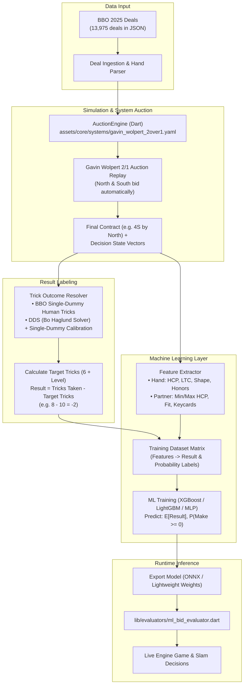

# Implementation Plan: Gavin Wolpert ML Bidding & Judgment Pipeline

## Goal Description
Build an end-to-end Machine Learning pipeline for Game and Slam judgment:
1. **Auction Generation**: Replay the 52-card deals from our extracted BBO championship dataset through our **Gavin Wolpert 2/1 bidding system** (`assets/core/systems/gavin_wolpert_2over1.yaml`).
2. **Outcome Calculation**: For each contract reached, compute the performance label:
   $$\text{Result} = \text{Tricks Taken} - \text{Target Tricks}$$
   *(e.g., in $4\heartsuit$, Target = 10 tricks. If 8 tricks are taken, $\text{Result} = 8 - 10 = -2$)*.
3. **Feature Representation**: Extract hand features (HCP, shape, controls, LTC, honor concentration) alongside partner's accumulated system constraints (`minHcp`, `maxHcp`, fit length, keycards).
4. **Model Training**: Train both a **Regression Model** ($\mathbb{E}[\text{Result}]$) and **Classification Models** ($P(\text{Contract Makes}), P(\text{Game}), P(\text{Slam})$).
5. **Runtime Integration**: Integrate ML predictions into our bidding engine to decide when to bid game, invite, or initiate slam investigations.

---

## Architectural Flow



---

## Metric Definition: `Result = Tricks Taken - Target`

For any contract at level $L$ ($L \in \{1, \dots, 7\}$):
$$\text{Target Tricks} = 6 + L$$

$$\text{Result} = \text{Tricks Taken} - \text{Target Tricks}$$

| Contract | Target Tricks | Tricks Taken | Result ($\Delta$) | Contract Status |
| :---: | :---: | :---: | :---: | :---: |
| **$4\heartsuit$** | 10 | 8 | **$-2$** | Down 2 (Failure) |
| **$4\heartsuit$** | 10 | 10 | **$0$** | Made Exactly (Success) |
| **$4\heartsuit$** | 10 | 11 | **$+1$** | Overtrick 1 (Success) |
| **$3\text{NT}$** | 9 | 10 | **$+1$** | Overtrick 1 (Success) |
| **$6\spadesuit$** | 12 | 11 | **$-1$** | Down 1 (Slam Failure) |
| **$6\spadesuit$** | 12 | 12 | **$0$** | Made Exactly (Slam Success) |

### Dual Learning Objectives:
1. **Expected Trick Margin (Regression Target)**:
   $$\hat{y} = \mathbb{E}[\text{Result}]$$
   Estimates expected surplus/deficit tricks.
2. **Win Probability (Classification Target)**:
   $$P(\text{Make}) = P(\text{Result} \ge 0)$$
   Directly guides IMP scoring thresholds:
   * Non-Vulnerable Game: Bid if $P(\text{Make}) \ge 40\text{--}45\%$
   * Vulnerable Game: Bid if $P(\text{Make}) \ge 35\text{--}40\%$
   * Small Slam: Bid if $P(\text{Make}) \ge 50\%$

---

## User Review Required

> [!IMPORTANT]
> **Tricks Taken Source Policy**:
> 1. When our Gavin Wolpert engine reaches the **exact same strain** as was played in the BBO vugraph match, we use the **actual single-dummy human tricks made** (100% human reality with real opening leads and finesses).
> 2. When our engine reaches a **different strain or level** (e.g. our engine bids 4♠ while BBO human table played in 3NT), we compute double-dummy tricks using the Bo Haglund DDS solver, calibrated by our single-dummy empirical adjustment distribution ($\Delta_{\text{human}}$).
>
> This gives complete coverage across all 13,975 deals while preserving human single-dummy realism.

---

## Proposed Changes

### Component 1: Gavin Wolpert Batch Replay Harness (Dart)
Run our existing compiled Gavin Wolpert 2/1 graph on the 13,975 BBO deals.

#### [NEW] `bin/replay_bbo_gavin_system.dart`
* Ingests `res/bbo_championships_2025_dataset.json`.
* Parses `md|...|` string into `Hand` and `Card` objects for North and South.
* Invokes `AuctionEngine.fromSystem(gavinSystem)` to bid North and South automatically until pass-out.
* Records:
  * Full bidding sequence.
  * Final contract (`level`, `strain`, `declarer`).
  * Accumulated constraints on partner (`minHcp`, `maxHcp`, fit length, shape).
  * Decision branch states (e.g., where a player had a choice between Pass, Invite, or Game).

---

### Component 2: Outcome & Label Generator (Python / Dart)
Computes target tricks, tricks made, and $\text{Result} = \text{Tricks} - \text{Target}$.

#### [NEW] `tools/generate_ml_dataset.py`
* Merges replayed contracts with BBO human trick outcomes and DDS ground-truth.
* Calculates:
  * `target_tricks = 6 + contract_level`
  * `result = tricks_made - target_tricks`
  * `is_made = (result >= 0)`
  * `is_game = (contract_level >= 4 and strain in ['H', 'S']) or (contract_level >= 3 and strain == 'N') or (contract_level >= 5)`
  * `is_slam = (contract_level >= 6)`
* Formats feature vectors into clean CSV / Parquet format: `data/gavin_ml_training_data.csv`.

---

### Component 3: Feature Engineering Matrix
Features extracted at the moment of decision:

| Feature Category | Features | Description |
| :--- | :--- | :--- |
| **My Hand (Point Count)** | `my_hcp`, `my_controls`, `my_losers_ltc` | Milton Work HCP (4-3-2-1), Controls (A=2, K=1), Losing Trick Count |
| **My Hand (Shape)** | `len_s`, `len_h`, `len_d`, `len_c`, `is_balanced` | Suit lengths, shape flags (5-4-3-1, 6-5, etc.) |
| **Honor Quality** | `h_points_in_fit`, `wasted_points_in_short` | Key card concentration in trump suit vs. wasted Q/J in short suits |
| **Partner Known State** | `partner_min_hcp`, `partner_max_hcp`, `partner_fit_len` | Constraints learned from partner's bids in Gavin Wolpert tree |
| **Fit & Strain** | `total_trump_fit`, `target_strain`, `target_level` | Combined fit length (e.g. 8, 9, 10) and strain (♠, ♥, ♦, ♣, NT) |
| **Vulnerability** | `is_vulnerable`, `opp_vulnerable` | Vulnerability state for IMP risk weighting |

---

### Component 4: Machine Learning Model Training (Python)

#### [NEW] `ml/train_game_slam_model.py`
* Trains two complementary models:
  1. **LightGBM / XGBoost Regressor**:
     * Predicts continuous `expected_result` ($\mathbb{E}[\text{Tricks} - \text{Target}]$).
     * High interpretability, handles non-linear honor combinations and shape interactions.
  2. **Calibrated Classifier**:
     * Predicts $P(\text{Result} \ge 0)$ (Probability of making contract).
* Cross-validation: Grouped by tournament / match ID (prevents deal leakage).
* Export: Saves model as lightweight JSON decision tree format or ONNX for instant execution in Dart without heavy runtime dependencies.

---

### Component 5: Dart Runtime ML Evaluator

#### [NEW] `lib/evaluators/ml_bid_evaluator.dart`
* Implements lightweight tree evaluation in Dart.
* Takes `(Hand myHand, HandConstraint partnerConstraint, String candidateBid, bool isVul)`.
* Returns `BidEvaluationResult(expectedTricksDelta: -0.3, makeProbability: 0.58)`.
* Plugs directly into `AuctionEngine` / `CompiledAuctionState` to dynamically resolve invitations and game/slam pushes.

---

## Verification Plan

### Phase 1: Engine Replay Verification
1. Run `dart run bin/replay_bbo_gavin_system.dart --limit 50`.
2. Verify:
   * BBO deals parse cleanly into `Hand` objects.
   * `AuctionEngine` executes Gavin Wolpert 2/1 rules to produce legal auctions and valid final contracts.
   * Records match count, contract distributions, and pass-out rates.

### Phase 2: Label & Feature Correctness
1. Run `python tools/generate_ml_dataset.py --verify`.
2. Inspect sample records to confirm:
   * For $4\heartsuit$ with 8 tricks taken: $\text{Target} = 10$, $\text{Result} = -2$, $\text{is\_made} = \text{False}$.
   * For $3\text{NT}$ with 10 tricks taken: $\text{Target} = 9$, $\text{Result} = +1$, $\text{is\_made} = \text{True}$.
   * Feature values match hand specifications.

### Phase 3: Model Accuracy & Calibration
1. Run `python ml/train_game_slam_model.py`.
2. Evaluate:
   * Mean Absolute Error (MAE) on $\text{Result}$ (Target: MAE $< 0.8$ tricks).
   * ROC-AUC and Brier Score on $P(\text{Make})$ (Target: AUC $> 0.85$).
   * Game push thresholds verify expected bridge theory (e.g. 24 HCP with 9-card fit has positive expected result).

### Phase 4: Dart Test Suite Regression
1. Run full test suite:
   ```powershell
   flutter test
   ```
   Ensure all 92 existing tests continue to pass with 0 regressions.
