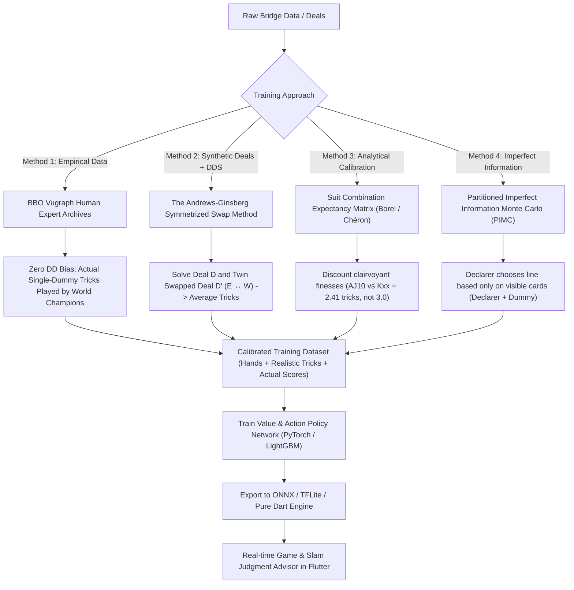

# Machine Learning Training Pipeline & Solving Double Dummy Bias in Bridge

## 1. Goal Description

When training a Machine Learning (ML) model or running Monte Carlo simulations to judge game and slam decisions, standard **Double Dummy Solvers (DDS)** suffer from a well-known flaw: **Double Dummy Bias (Clairvoyance Bias)**. 

### The Problem:
With holdings like **`A-J-10` opposite `K-3-2`**, a human single-dummy declarer facing hidden cards has to guess or take a 50% finesse for the Queen (expected return $\approx 2.4$ tricks). A Double Dummy Solver, however, "sees" all 52 cards through the backs of the opponents' cards:
- On deals where the Queen is onside, it finesses successfully (3 tricks).
- On deals where a two-way guess is possible, it **always guesses right** (100% success rate instead of 50%).
- On defense, DDS finds miracle opening leads and unblocks that no human could ever find.

As a result, pure Double Dummy simulations predict contracts make **0.5 to 0.8 tricks more** than real human play, overvaluing thin games and slams. 

This document details **how to train the ML model accurately** and the **four proven methods to eliminate Double Dummy Bias**.

---

## 2. Four Proven Methods to Eliminate Double Dummy Bias



---

### Method 1: Supervised Learning on Real Human Expert Archives (The Gold Standard)

The most direct way to eliminate Double Dummy Bias is to **train on real human play** rather than double-dummy calculations.

- **Data Sources**:
  - **BBO Vugraph Archives**: Decades of world championships (Bermuda Bowl, Venice Cup, Spingold, Vanderbilt, Cavendish).
  - Contains hundreds of thousands of boards played by world champions (Zia Mahmood, Bob Hamman, Eric Rodwell, Jeff Meckstroth, etc.).
- **Data Format**:
  - PBN (Portable Bridge Notation) and LIN files recording:
    - 4 hands.
    - Full auction.
    - Opening lead.
    - **Actual single-dummy tricks made** by world-class humans.
- **Why this solves the problem**:
  - When a world champion holds `AJ10` opposite `K32`, they misguess the Queen roughly 50% of the time. The actual recorded tricks will reflect reality, not clairvoyance.

---

### Method 2: The Symmetrized Reflection Method (Andrews-Ginsberg Twin Swapping)

If you generate synthetic deals and use a Double Dummy Solver (which is fast and can generate 10,000,000 boards on demand), you can eliminate the clairvoyant finesse bias using **Opponent Symmetrization**:

For any simulated board $D$:
1. Identify the cards held by East and West in suits where an unforced finesse or guess is required (e.g. the Queen of Hearts).
2. Create a "Twin Board" $D'$ where the unconstrained cards of East and West are swapped ($E \leftrightarrow W$).
3. Run the Double Dummy Solver on both $D$ and $D'$:
   - On $D$, the Queen is with East $\implies$ DDS takes 3 tricks.
   - On $D'$, the Queen is with West $\implies$ DDS takes 2 tricks.
4. Set the target trick count for training to the **average of the twin pair**:
   $$T_{\text{calibrated}} = \frac{\text{DDS}(D) + \text{DDS}(D')}{2} = \frac{3 + 2}{2} = 2.5 \text{ tricks}$$

> [!NOTE]
> This mathematically forces all 50/50 finesses to yield exactly 2.5 tricks instead of 3.0 tricks, neutralizing the solver's clairvoyance across the dataset!

---

### Method 3: Analytical Suit Combination Expectancy Tables (Borel & Chéron Tables)

In classical bridge mathematics, exact probabilities for all 52 card combinations have been tabulated by Émile Borel and André Chéron.

Instead of letting the ML model learn raw Double Dummy tricks:
1. Feature extraction calculates the **Analytical Expected Value** for each suit:
   - `A-K-Q-J`: 4.00 tricks (100%).
   - `A-K-Q-x`: 3.00 tricks (plus length probability).
   - `A-J-10` opposite `K-x-x`: **2.41 expected tricks** (accounts for 50% Queen finesse and 3-2 vs 4-1 breaks).
   - `A-Q-x-x` opposite `x-x-x`: **1.50 expected tricks** (50% finesse).
2. The ML model receives these **analytical expectations** as feature inputs alongside raw card bits. This prevents the neural network from ever believing that `AJ10` opposite `Kxx` is guaranteed 3 tricks!

---

### Method 4: Imperfect Information Simulation (PIMC / Single-Dummy Play Engine)

Rather than solving all 4 hands simultaneously:
1. Declarer only sees Declarer + Dummy.
2. Declarer chooses the mathematically optimal single-dummy play line:
   - For `AJ10` opposite `K32`, Declarer runs the Jack (or low to 10).
3. Defender only sees Defender hand + Dummy.
4. The simulation plays out the hand trick-by-trick with incomplete information.
5. The result is pure single-dummy tricks.

---

## 3. Step-by-Step Training Pipeline

### Step 1: Dataset Generation & Curation
We can build a dataset of 500,000 boards combining:
- **70% Real Expert Boards**: Scraped from BBO Vugraph archives and ACBL tournament PBN files.
- **30% Symmetrized Synthetic Boards**: Generated using our `DealGenerator` with the Andrews-Ginsberg $E \leftrightarrow W$ twin swap.

### Step 2: Feature Representation
For each board at decision point:
- **Player Hand**: 52-dimensional binary vector (1 = card present, 0 = absent).
- **Partner Inferred Bounds**:
  - `[min_hcp, max_hcp]`
  - `[min_spades, max_spades]`, `[min_hearts, max_hearts]`, `[min_diamonds, max_diamonds]`, `[min_clubs, max_clubs]`
- **Trump Strain**: One-hot vector `[♣, ♦, ♥, ♠, NT]`.
- **Vulnerability**: One-hot vector `[Both Non-Vul, We Vul, They Vul, Both Vul]`.
- **Target Label**: Actual tricks made ($y \in [0..13]$) and Game/Slam outcome.

### Step 3: Model Architecture
A compact, highly accurate **Multi-Task Neural Network**:
- **Shared Backbone**: Dense(128) $\to$ LayerNorm $\to$ ReLU $\to$ Dropout(0.1) $\to$ Dense(64) $\to$ LayerNorm $\to$ ReLU.
- **Head 1 (Expected Tricks)**: Regression output $\hat{T} \in [0.0, 13.0]$.
- **Head 2 (Trick Probability Distribution)**: Softmax over 14 classes ($P(T=0) \dots P(T=13)$).
- **Head 3 (Decision Recommendation)**: Softmax over 5 classes:
  1. `Signoff` (Partscore)
  2. `Investigate Game` (Invitational trial bid / 2NT)
  3. `Bid Game` (Commit to 3NT / 4M / 5m)
  4. `Investigate Slam` (Serious 3NT / RKCB / Kickback / Cuebid)
  5. `Bid Slam` (6x / 7x)

### Step 4: Model Export & On-Device Flutter Integration
- The trained PyTorch model is exported to:
  - **TFLite (`.tflite`)** or **ONNX (`.onnx`)** or a **lightweight pure-Dart matrix inference class** (~150 KB file).
- The model runs directly on the user's device in **< 1 millisecond**, requiring no internet connection or external servers.

---

## 4. How the Decision Advisor Will Look in the App

When a user or AI reaches a borderline decision in the practice quiz or bidding lab:

```
┌────────────────────────────────────────────────────────────────────────┐
│ 🎯 GAME & SLAM ADVISOR (Kokish-Kraft / 2/1 GF)                        │
├────────────────────────────────────────────────────────────────────────┤
│ Contract Target: 4♥ (Vulnerable)                                       │
│                                                                        │
│ 📊 Calibrated Make Probability: 44.2%  (Single-Dummy Adjusted)         │
│ ⚠️ Note: Finesse in Hearts (AJ10 vs Kxx) discounted to 50% expectancy  │
│                                                                        │
│ Expected Values (IMPs):                                                │
│ • Pass (Partscore in 2♥):  +110 (EV: +3.1 IMPs)                        │
│ • Game Try (Trial Bid 2♠): +140 to +620 (EV: +4.8 IMPs) ⭐ RECOMMENDED │
│ • Blast 4♥ (Game Direct):  -100 or +620 (EV: +2.9 IMPs)                │
│                                                                        │
│ 💡 Recommendation: INVESTIGATE GAME                                    │
│ "Partner showed 6-9 HCP. Your 14 HCP with 3 Aces and fitting honors   │
│ warrants a game try, but lacks the pure power to blast 4♥ directly."   │
└────────────────────────────────────────────────────────────────────────┘
```

---

## 5. Verification Plan

### Automated Tests
1. **Double Dummy Bias Verification Test**:
   - Compare raw DDS output vs Symmetrized twin-swap output on `AJ10` vs `K32` deals.
   - Assert that the calibrated trick count yields $\approx 2.4$ to $2.5$ tricks (and never $3.0$).
2. **Threshold Accuracy Test**:
   - Verify that Vul Game invitations trigger at $\ge 37\%$ EV, while Non-Vul triggers at $\ge 50\%$.
   - Verify that Small Slam triggers only when key controls are accounted for and $P(\text{slam}) \ge 50\%$.
3. **Regression Tests**:
   - Maintain 100% pass rate across the full test suite (92 tests).
