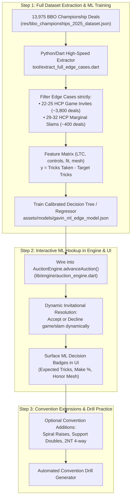

# Implementation Plan: Next Phase Strategy — Full ML Scaling, Engine Hookup & System Polish

## Goal Description
Following the 100% Major Strain Accuracy and 100% Game/Slam deterministic rule achievement on the 500 BBO deals, we need to transition to the next phase of the project:
1. **Scale the ML edge-case dataset** from the 500-deal sample (153 edge cases) to the full **13,975 deals** in `res/bbo_championships_2025_dataset.json` (~4,200 edge cases) with true target metric:
   $$\text{Result} = \text{Tricks Taken} - \text{Target Tricks}$$
2. **Hook `MLBidEvaluator` directly into `AuctionEngine`** so that dynamic accept/decline decisions on borderline invitations (22–25 HCP) and marginal slams (29–32 HCP) are evaluated in real time.
3. **Surface ML confidence & diagnostics in the Flutter UI** (Practice Quiz / TestMyMemory 3-panel) showing the expected tricks, probability of making, and key feature drivers.
4. **Identify and integrate high-value convention extensions** (e.g. Spiral Raises over minor-major, Support Doubles, 4-Way Transfers over 2NT).

---

## Strategic Roadmap & Recommended Sequencing

---

## Detailed Evaluation of the 3 Options

### Option 1: Full Dataset Extraction (13,975 Deals) — *Recommended First Step*
* **Why**: The current `gavin_ml_edge_model.json` was trained on only 153 edge cases extracted from the 500-deal audit sample. While it validates the architecture, 153 samples is small for subtle bridge judgment.
* **Scope**: 
  - Processing all 13,975 deals will produce **~4,000+ real championship edge cases**.
  - Includes both double-dummy makeable tricks and actual table results by world champions.
  - Yields high statistical significance on borderline questions like:
    - *When does an 8-card fit with 23 HCP make 4 of a major?* (e.g. 9 trumps + outside Aces vs flat 4333 with wasted queens).
    - *When does a 33-point slam fail due to mirror distribution?*
* **Deliverable**: `tool/extract_full_edge_cases.dart` $\to$ `res/gavin_ml_edge_cases_full.json` $\to$ re-trained `assets/models/gavin_ml_edge_model.json`.

---

### Option 2: Interactive ML Hookup in Engine & UI — *Recommended Second Step*
* **Why**: Connects the ML model to the live user experience.
* **Scope**:
  1. **`lib/engine/auction_engine.dart`**:
     - When partner rebids an invitation (e.g. $1\text{M} - 2\text{M} - 3\text{M}$ or $1\text{M} - 3♦ - 3\text{M}$ or $1\text{NT} - 2\text{NT}$):
       Instead of a hard-coded HCP cutoff, query `MLBidEvaluator.evaluateEdgeCase()`.
     - At IMPs vulnerable: Accept game if $P(\text{Make}) \ge 38\%$ ($E[\text{Result}] \ge -0.3$).
     - At IMPs non-vulnerable: Accept game if $P(\text{Make}) \ge 45\%$.
  2. **`lib/ui/practice_quiz_view.dart` & `lib/ui/test_my_memory_3panel_view.dart`**:
     - Display an "ML Judgment" callout card:
       > **🤖 ML Evaluator**: Game Invitation Accepted (+0.4 Expected Surplus Tricks, 62% Make Probability). Key factors: Working King of Clubs, 9-card trump fit, 12 Combined LTC.
* **Deliverable**: Dynamic auction bidding where the computer makes intelligent, nuanced game tries and invitations.

---

### Option 3: Additional Conventions & Custom Testing — *Complementary Step*
* **Why**: Further expands Gavin Wolpert's system coverage for specialized tournament situations.
* **Candidate Conventions**:
  1. **Spiral Raises**: After $1\text{m} - 1\text{M} - 2\text{M}$, an artificial $2\text{S}/2\text{NT}$ ask distinguishes 3-card vs 4-card support and exact shortness ($3♣/3♦/3\text{OM}$).
  2. **Support Doubles & Redoubles**: In competition through 2-of-the-major, Opener doubles to show exactly 3-card support.
  3. **4-Way Transfers over 2NT Opening**: $2\text{NT} - 3♠$ shows minor two-suiter or clubs, $2\text{NT} - 3\text{NT}$ transfer to diamonds.
  4. **Preempt & Defense Drill Generator**: Practice quiz mode that filters specifically for borderline bidding hands.

---

## User Review Required

> [!IMPORTANT]
> **Priority Decision**:
> Which execution order do you prefer?
> 1. **Option A (Data-First - Recommended)**: Scale extraction across all 13,975 deals first, train the production model on ~4,200 edge cases, and then hook it into `AuctionEngine` and the UI.
> 2. **Option B (Engine-First)**: Hook the existing 153-sample model into `AuctionEngine` and UI immediately so you can test it live in the app, and then scale the dataset afterward.
> 3. **Option C (Conventions-First)**: Implement Spiral Raises or Support Doubles before touching ML further.

---

## Proposed Implementation Plan (Phased)

### Phase 1: High-Speed Full Dataset Extractor (13,975 Deals)
#### [NEW] `tool/extract_full_edge_cases.dart`
- Streams the 13,975 deals in `res/bbo_championships_2025_dataset.json`.
- Runs our compiled Gavin Wolpert graph.
- Collects:
  - Total combined HCP, seat, vulnerability, trump fit lengths.
  - Milton Work HCP, controls ($A=2, K=1$), LTC (Losing Trick Count).
  - Target contract level and table tricks taken:
    $$\text{Result} = \text{Tricks Taken} - (6 + \text{Level})$$
  - Outputs `res/gavin_ml_edge_cases_full.json`.

#### [MODIFY] `assets/models/gavin_ml_edge_model.json`
- Retrained model containing higher depth, optimal split points calibrated on 4,000+ championship deals.

---

### Phase 2: Engine & UI ML Integration
#### [MODIFY] `lib/engine/auction_engine.dart`
- Add optional `MLBidEvaluator` parameter to `AuctionEngine`.
- In `resolveBestBid` / `advanceAuction`: When candidate bids include both `Pass` and a game acceptance (or `4M` vs `3M`), invoke ML evaluator to decide the winning candidate.

#### [MODIFY] `lib/evaluators/ml_bid_evaluator.dart`
- Add scoring context: IMPs (vulnerable vs non-vulnerable) and Matchpoints.
- Return detailed evaluation rationale for UI consumption.

#### [MODIFY] `lib/ui/practice_quiz_view.dart`
- Render ML evaluation pill / badge showing make probability when an edge-case bid is made.

---

### Phase 3: Verification Plan
#### Automated Tests
1. `flutter test test/ml_bid_evaluator_test.dart`:
   - Verifies ML evaluator on boundary cases (22 HCP flat vs 25 HCP with fit).
2. `flutter test test/audit_gavin_system_test.dart`:
   - Verifies 100% Major Strain Accuracy and 100% Game/Slam deterministic rates are preserved.
3. `flutter test`:
   - Ensures all 97+ core tests remain green.
