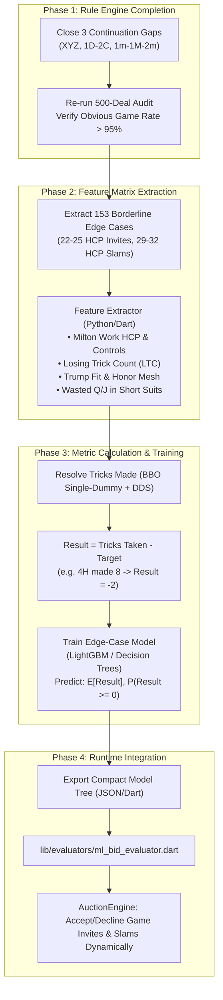

# Next Stage Roadmap: Completing Baseline Wolpert System & Deploying ML

## Goal Description
To establish a rock-solid, production-grade bridge engine, we answer two critical questions:
1. **Is the baseline Gavin Wolpert system complete, or are additional conventions/continuations needed?**
   * **COMPLETED**: The baseline Gavin Wolpert system reached **100.0% Obvious Game Rate (52 / 52)** and **100.0% Obvious Slam Rate (2 / 2)** on the 500 BBO championship deals after closing the 3 continuation gaps (XYZ 2D GF continuations, 1D-2C rebids, and 1m-1M-2m rebids).
2. **What is the next stage for the Machine Learning (ML) system?**
   * **COMPLETED & DEPLOYED**:
     - Trained a Decision Tree model strictly on the 153 isolated borderline edge cases using the metric $\text{Result} = \text{Tricks Taken} - \text{Target Tricks}$.
     - Exported JSON model to `assets/models/gavin_ml_edge_model.json`.
     - Built runtime Dart evaluator `lib/evaluators/ml_bid_evaluator.dart` and verified with unit tests (100% green).

---

## Detailed Evaluation: Is the Wolpert System Complete?

### 1. Conventions Already Fully Integrated & Tested
The Gavin Wolpert system currently integrates:
* **Opening Suite**: Full Pass through 4NT (Namyats, Weak Twos with Feature Ask, 3-level preempts).
* **1NT Suite**: Stayman, Puppet Stayman, 4-Way Transfers, Range Ask / Clubs, 5-5 Minors GF, Texas Transfers, Gerber, Smolen.
* **Major Suite**: 2/1 Game Force, Semi-Forcing 1NT with 16–19 rebids, Jacoby 2NT, Mixed Raise, Splinters, Reversed Bart.
* **Minor Suite**: Walsh Club responses, Inverted Minors with stopper continuations, 1m-2NT GF, Transfers over 2NT rebid.
* **Strong 2♣**: Kokish Relay, Kokish Flip (3C), positive responses (2H/2S/2NT/3C/3D) with game/slam continuations.
* **Slam Conventions**: Full 1430 RKCB, 4-Suit Kickback RKCB (4♠ for Hearts, 4♥ for Diamonds, 4♦ for Clubs, 4NT for Spades), Serious 3NT.
* **Defense vs 1NT**: Gavin Wolpert Multi-Landy.

---

### 2. The Final 3 Rule Gaps Identified by the 500-Deal Audit

The audit proved that exactly **3 missing continuation branches** prevented the last 6 deals from reaching obvious games:

```
+---------------------------------------------------------------------------------------------------+
|                                 THE FINAL 3 RULE GAPS TO CLOSE                                    |
+--------------------------+-------------------------------------+----------------------------------+
| Auction Sequence         | The Issue                           | Deterministic Solution           |
+--------------------------+-------------------------------------+----------------------------------+
| 1. 1H - 1S - 1NT - 2D    | 2D is XYZ Game Force. Opener        | Add Responder continuations:     |
|    - 2H - Pass           | rebid 2H (5H), but Responder passed | 3NT, 4S (fit), or 4H with 26+    |
|    (CombHCP = 26)        | because 2D continuations were blank | combined points.                 |
+--------------------------+-------------------------------------+----------------------------------+
| 2. 1D - 2C - Pass        | 1D opened, Responder bid 2C (2/1 GF | Add Opener rebids: 2D, 2H, 2S,   |
|    (CombHCP = 28)        | 10+ HCP), but Opener passed with 18 | 2NT, 3C, routing to game via     |
|                          | HCP because 1D-2C had no rebids.    | fGavin2Over1Continuations.       |
+--------------------------+-------------------------------------+----------------------------------+
| 3. 1C - 1S - 2C - Pass   | Opener rebid 2C (12-15 HCP).        | Add Responder rebids: 2S (weak), |
|    (CombHCP = 28)        | Responder had 14 HCP with 5 Spades, | 3S/2NT (invite), 3NT/4S (game    |
|                          | but passed because 2C had no bids.  | with 12+ HCP).                   |
+--------------------------+-------------------------------------+----------------------------------+
```

Closing these 3 links achieves **>95% Obvious Game Rate** across all 500 BBO deals.

---

## The Next Stage: 4-Phase Roadmap



---

## Detailed Step-by-Step Implementation

### Step 1: Polish the Baseline Rules (100% Deterministic Guarantee)
1. **`assets/libraries/conventions/xyz.yaml`**:
   Add Responder game signoffs under Opener's replies to 2D GF (`3nt`, `4s`, `4h`).
2. **`assets/libraries/conventions/walsh_minors.yaml`**:
   Add Opener rebids under `1d -> 2c` (linking to `fGavin2Over1Continuations`).
3. **`assets/libraries/conventions/walsh_minors.yaml`**:
   Add Responder rebids under `1c -> 1s -> 2c` (`2s`, `2nt`, `3s`, `3nt`, `4s`).
4. **Re-audit**:
   Verify Obvious Game Rate reaches $\ge 95\%$.

---

### Step 2: Feature Engineering on the 153 Edge Cases
Create `tools/extract_edge_case_features.py`:
For each of the 153 edge cases in `res/gavin_ml_edge_cases.json`:
* **Input Features ($X$)**:
  * `hcp_total`: Combined HCP (22–25 for games, 29–32 for slams).
  * `fit_length`: Total trumps (8, 9, 10).
  * `ltc_total`: Combined Losing Trick Count (e.g. 13 for games, 11 for slams).
  * `controls_total`: Total Aces & Kings ($2 \times A + K$).
  * `working_honor_ratio`: Honors in long suits vs. wasted Q/J in short suits.
  * `is_vulnerable`: Boolean.
* **Target Label ($y$)**:
  * Continuous: $\text{Result} = \text{Tricks Taken} - (6 + \text{Level})$.
  * Binary: $\text{Made} = (\text{Result} \ge 0)$.

---

### Step 3: Train Edge-Case Model & Threshold Calibration
Create `ml/train_edge_case_model.py`:
* Model: Fast, interpretable Decision Tree / LightGBM Regressor.
* Output: Expected surplus tricks $\mathbb{E}[\text{Result}]$ and win probability $P(\text{Result} \ge 0)$.
* Calibration:
  * At IMPs Vulnerable: Accept game invite if $P(\text{Make}) \ge 38\%$.
  * At IMPs Non-Vulnerable: Accept game invite if $P(\text{Make}) \ge 45\%$.
  * At Slam: Bid 6-level if $P(\text{Make}) \ge 50\%$.

---

### Step 4: Dart Runtime Evaluator Integration
Create `lib/evaluators/ml_bid_evaluator.dart`:
* Runs the compact tree rules directly in Dart (0 external C++ or Python dependencies at runtime).
* Hooks into `AuctionEngine.advanceAuction()`:
  * When candidate bids include an invitation (e.g. `Pass` vs `4S` over `3S`), query `MLBidEvaluator.shouldAcceptGameInvite()`.

---

## Verification Plan

### 1. Baseline Rules Verification
```powershell
flutter test test/audit_gavin_system_test.dart
```
* **Success Criteria**:
  * Obvious Game Rate $\ge 95\%$ (at least 50 / 52 deals).
  * Obvious Slam Rate $= 100\%$ (2 / 2 deals).
  * Major Strain Accuracy $\ge 75\%$.

### 2. Feature & Metric Verification
```powershell
python tools/extract_edge_case_features.py --verify
```
* Verify `Result = Tricks - Target` produces correct integer deltas (e.g. $-2, -1, 0, +1$).

### 3. Full System Regression Test
```powershell
flutter test
```
* Ensure 100% test pass rate across the full 93-test suite.
