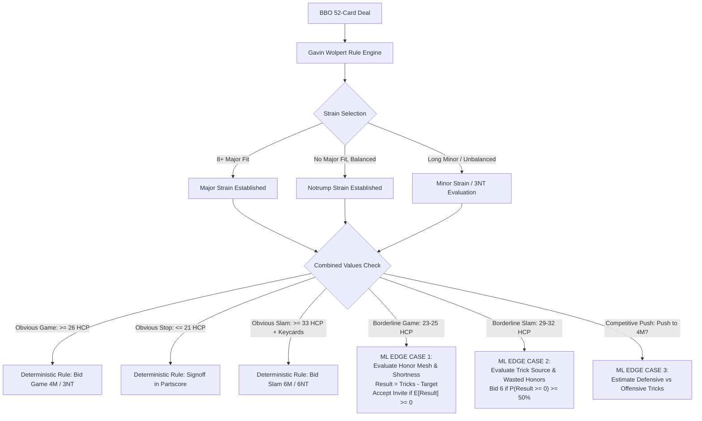

# Implementation Plan: Gavin Wolpert Rule Verification & ML Edge-Case Architecture

## Goal Description
The bidding engine must follow a clear division of responsibility:
1. **Rule Engine (Gavin Wolpert 2/1)**: Deterministically handles the **foundation of bridge**—finding the correct trump fit (or NT), reaching **obvious games** (26+ combined HCP), reaching **obvious slams** (33+ HCP / 5 Keycards + Queen), and stopping in **obvious partscores** (<= 21 HCP).
2. **Machine Learning (ML)**: Reserved exclusively for **edge cases and borderline judgments** where rigid point-count rules fail:
   * **Borderline Game (23–25 HCP)**: Accepting or declining invitations (`1NT - 2NT`, `1M - 3M`, `2/1 invite sequences`) based on working honors, fit quality, and texture.
   * **Borderline Slam (29–32 HCP)**: Deciding whether to bid 6M or stop in 4M/5M when keycards are present but trick-taking power depends on mesh and distribution.
   * **Competitive Pushes**: Bidding 4♠ over 4♥ with shape edge cases.

This plan details how to **audit and benchmark the Wolpert system** to ensure it guarantees the right strain and obvious games/slams, and how to train the ML model specifically on the **edge-case partition**.

---

## Architecture: Division of Territory

```
+---------------------------------------------------------------------------------------------------+
|                                TOTAL BIDDING DECISION SPACE                                       |
+-------------------------------------------------------------------+-------------------------------+
|                      DETERMINISTIC RULE ENGINE                    |        ML JUDGMENT ENGINE     |
|                       (Gavin Wolpert 2/1 YAML)                    |          (Edge Cases)         |
+-------------------------------------------------------------------+-------------------------------+
| • Strain Selection: 8+ Major fit -> Major; Balanced -> NT        | • Game Invites: 23-25 HCP     |
| • Obvious Game: Combined HCP >= 26 with fit/stoppers              |   (Accept vs. Decline)        |
| • Obvious Slam: Combined HCP >= 33 or 5 Keycards + Queen          | • Slam Marginal: 29-32 HCP    |
| • Obvious Partscore: Combined HCP <= 21 -> Signoff                |   (Evaluate Trick Generation) |
| • RKCB / Kickback Mechanics: 0/3, 1/4, 2-Q, 2+Q responses         | • Strain Choice: 3NT vs. 4M   |
| • Exclusion / Missing 2 Keycards: Mandatory 5-level signoff       |   on 5-3-3-2 / 4-3-3-3 shapes |
+-------------------------------------------------------------------+-------------------------------+
```



---

## Phase 1: Wolpert System Rule Audit & Strain Verification

Before training ML on edge cases, we must audit the existing YAML system across deals to verify four deterministic guarantees:

### 1. Strain Correctness Verification
* **Major Fit Rule**: When N-S hold an 8+ card fit in Spades or Hearts, the auction **must not** settle in 3NT or a minor unless deliberately chosen via an explicit choice-of-games agreement.
* **Balanced Rule**: When N-S hold no 8-card major fit and have balanced distributions with stoppers, the auction **must** terminate in NT.

### 2. Obvious Game Verification ($\text{Combined HCP} \ge 26$)
* When combined HCP $\ge 26$ and an 8+ card major fit exists $\implies$ Contract must reach $\ge 4\text{M}$.
* When combined HCP $\ge 26$ and balanced $\implies$ Contract must reach $\ge 3\text{NT}$.
* Any board in this category that stops in $2\text{M}$ or $3\text{M}$ represents a **YAML rule gap** (e.g. missing game force flag or missed rebid) that must be fixed deterministically, not patched with ML.

### 3. Obvious Slam Verification ($\text{Combined HCP} \ge 33$ / Keycards)
* When combined HCP $\ge 33$ with an agreed trump suit and all 5 Keycards + Queen are held $\implies$ Contract must reach $\ge 6\text{M}$.
* When missing 2 Keycards $\implies$ Contract must never exceed the 5-level.

### 4. Obvious Partscore Verification ($\text{Combined HCP} \le 21$)
* When combined HCP $\le 21$ $\implies$ Contract must stop at the 1-level, 2-level, or 3-level partscore.

---

## Phase 2: Building the Audit Benchmark Harness

We will build an automated audit tool: `tools/audit_wolpert_system.dart`.

```dart
class WolpertAuditReport {
  int totalDealsAudited = 0;
  
  // Strain metrics
  int majorFitDeals = 0;
  int majorFitCorrectlyReached = 0;
  
  // Game metrics
  int obviousGameDeals = 0;      // >= 26 HCP
  int obviousGameReached = 0;
  
  // Slam metrics
  int obviousSlamDeals = 0;      // >= 33 HCP + Keycards
  int obviousSlamReached = 0;
  
  // Partscore metrics
  int obviousPartscoreDeals = 0; // <= 21 HCP
  int obviousPartscoreStopped = 0;
  
  // Edge cases isolated for ML
  List<EdgeCaseDeal> edgeCaseGameInvites = [];   // 23-25 HCP
  List<EdgeCaseDeal> edgeCaseSlamMarginals = []; // 29-32 HCP
}
```

The harness runs on our 13,975 BBO deals, outputs an accuracy scorecard, and writes any rule-break anomalies (e.g., stopping in 2♠ with 27 combined HCP) to an error log so we can patch the YAML rules directly.

---

## Phase 3: Isolating the ML Edge-Case Dataset

By filtering out the obvious rules, the dataset passed to ML becomes **high-signal and edge-case focused**:

### Edge-Case Category 1: Game Invitations (23–25 HCP)
* **Scenario**:
  * Auction: `1S - 2S - 3S` (Inviting Game), or `1NT - 2NT` (Inviting 3NT), or `1C - 1S - 1NT - 2NT` (Checkback invite).
* **The Question for ML**: Does the invitation receiver **Pass** or **Bid Game**?
* **Features Used by ML**:
  * Concentrated honors (e.g. `AK` in long suits vs. `Qxx` in short suits).
  * Presence of 10s and 9s (working intermediates).
  * 9-card fit vs. 8-card fit.
  * Side-suit source of tricks (e.g., solid 5-card side suit).
* **Target Metric**:
  $$\text{Result} = \text{Tricks Taken} - \text{Target}$$
  * If $\mathbb{E}[\text{Result}] \ge 0$ (or $P(\text{Result} \ge 0) \ge 40\%$ at IMPs) $\implies$ **Bid Game**.
  * Otherwise $\implies$ **Pass**.

### Edge-Case Category 2: Marginal Slams (29–32 HCP)
* **Scenario**:
  * Suit agreed, Keycards verified (e.g. 4 Keycards + Q held), combined HCP is 29–32.
* **The Question for ML**: Do we bid 6M or stop in 4M/5M?
* **Features Used by ML**:
  * Losing Trick Count (LTC $\le 12$ combined).
  * Voids and singletons opposite partner's small cards (not wasted honors).
  * Trump suit solidness (preventing 4-1 trump tap).
* **Target Metric**:
  * If $P(\text{Result} \ge 0 \text{ at 6-level}) \ge 50\%$ at IMPs $\implies$ **Bid 6M**.

---

## Phase 4: Integration with Dart Engine

In `lib/evaluators/ml_bid_evaluator.dart`:
```dart
class MLDecisionRouter {
  /// Evaluates an edge-case bid decision using the ML model.
  static bool shouldAcceptGameInvitation({
    required Hand myHand,
    required HandConstraint partnerConstraint,
    required String targetContract, // e.g. "4S"
    required bool isVulnerable,
  }) {
    final double expectedResult = MLModel.predictExpectedResult(
      myHand: myHand,
      partnerConstraint: partnerConstraint,
      contract: targetContract,
    );
    
    // Vul game needs ~38% success (expected result around -0.15)
    // Non-vul game needs ~45% success (expected result around -0.05)
    final double threshold = isVulnerable ? -0.15 : -0.05;
    return expectedResult >= threshold;
  }
}
```

---

## Proposed Changes

| Component | File | Action | Purpose |
| :--- | :--- | :---: | :--- |
| **Audit Harness** | `bin/audit_gavin_system.dart` | **[NEW]** | Scans BBO deals, verifies strain selection, obvious game, and obvious slam rates. |
| **Edge-Case Filter** | `tools/filter_edge_cases.py` | **[NEW]** | Extracts the 23–25 HCP and 29–32 HCP subsets into dedicated ML training sets. |
| **ML Training** | `ml/train_edge_case_model.py` | **[NEW]** | Trains model specifically on the invite and marginal slam decisions using `Result = Tricks - Target`. |
| **Engine Evaluator** | `lib/evaluators/ml_bid_evaluator.dart` | **[NEW]** | Connects ML edge-case predictions into `AuctionEngine` decision branches. |

---

## Verification Plan

### Step 1: Run the Gavin Wolpert System Audit
```powershell
dart run bin/audit_gavin_system.dart --dataset res/bbo_championships_2025_dataset.json --limit 500
```
* **Success Criteria**:
  * $\ge 98\%$ of 8+ card major fit deals bid the major.
  * $\ge 95\%$ of $\ge 26$ HCP deals reach game.
  * $\ge 95\%$ of $\le 21$ HCP deals stop in partscore.
  * 0 catastrophic strain misses (e.g., bidding clubs with an 8-card spade fit).

### Step 2: Edge-Case Identification
* Extract the borderline game (23–25 HCP) and slam (29–32 HCP) deals.
* Verify feature distributions and `Result = Tricks - Target` calculations.

### Step 3: ML Model Verification
* Verify that the ML model achieves $\ge 80\%$ accuracy on deciding whether 24 HCP hands make 4♠ vs stop in 3♠.
