# TODO: YAML System & Convention Categorization Plan

## 1. Motivation & Core Problem

As our bridge bidding ecosystem grows, having all convention files in a single flat directory (`assets/libraries/conventions/`) and all system files in a single flat directory (`assets/core/systems/`) creates several challenges:

1. **System Divergence**:
   - **2/1 Game Forcing (2/1 GF)**: 5-card majors, 15–17 Strong NT, 2-over-1 responses are 100% Game Forcing ($12\text{–}13+$ HCP), 1NT response over 1M is forcing or semi-forcing ($6\text{–}12$ HCP).
   - **Standard American (SAYC)**: 5-card majors, 15–17 Strong NT, 2-over-1 responses are $10+$ HCP forcing for **one round only**, 1NT response is strictly non-forcing ($6\text{–}9$ HCP).
   - **UK Acol**: 4-card majors, 12–14 Weak NT, 2-over-1 responses are non-forcing ($8\text{–}9+$ HCP, $4+$ cards), 1NT response is $6\text{–}9$ HCP.
2. **Openings Reusability Paradox**:
   - **1-level suit openings ($1\clubsuit, 1\diamondsuit, 1\heartsuit, 1\spadesuit$)**: Highly system-dependent (5-card vs 4-card majors, better minor vs Walsh vs natural 4-card minors).
   - **2-level & 3-level openings ($2\clubsuit, 2\diamondsuit, 2\heartsuit, 2\spadesuit, 2\text{NT}, 3\text{x}$)**: Broadly universal across systems (e.g. Weak Two in Diamonds/Hearts/Spades, Strong $2\clubsuit$ artificial, 3-level preempts).
3. **Convention Organization**:
   - Conventions belong to distinct auction phases: Defense to interference, NT response structures, Major suit raises, Checkback/Relays, and Slam bidding.

---

## 2. Proposed Directory Structure

```
assets/
├── systems/                                  # Master System Profiles
│   ├── two_over_one/
│   │   ├── us_standard_2over1.yaml           # Standard American 2/1 GF
│   │   └── gavin_wolpert_2over1.yaml         # Gavin Wolpert Master Series 2/1
│   ├── standard_american/
│   │   └── sayc.yaml                         # Standard American Yellow Card (SAYC)
│   ├── acol/
│   │   └── uk_acol_4cm.yaml                  # Standard UK Acol (4CM, Weak NT)
│   └── strong_club/
│       └── three_way_club_5cm.yaml           # Three-Way / Polish Club
│
├── openings/                                 # Opening Bids & Response Structures
│   ├── universal/                            # System-independent (usable by 2/1, SA, Acol)
│   │   ├── weak_twos.yaml                    # 2D, 2H, 2S (5-10 HCP, 6 cards, Ogust/Feature/Vinny)
│   │   ├── strong_two_clubs.yaml             # 2C artificial 22+ HCP / 8.5+ tricks (2D waiting)
│   │   ├── strong_two_notrump.yaml           # 2NT balanced 20-21 HCP (Puppet Stayman/Transfers)
│   │   └── preempts_3level.yaml              # 3C, 3D, 3H, 3S (weak 7-card suit)
│   │
│   ├── two_over_one/                         # 5-Card Majors & 2/1 Game Forcing
│   │   ├── major_responses_2over1.yaml       # 1H/1S with 2/1 GF and semi-forcing 1NT
│   │   ├── gavin_majors_2over1.yaml          # Gavin Wolpert major structure
│   │   ├── natural_minors.yaml               # Standard 3+ card better-minor
│   │   └── walsh_minors.yaml                 # Walsh style 1C/1D
│   │
│   ├── standard_american/                    # 5-Card Majors & 2/1 Forcing 1 Round
│   │   └── major_responses_sayc.yaml         # 1H/1S with 2/1 forcing 1R (10+ HCP) and non-forcing 1NT
│   │
│   └── acol/                                 # 4-Card Majors & Weak NT
│       ├── major_responses_acol.yaml         # 1H/1S with 4-card support & non-forcing 2/1
│       └── minor_responses_acol.yaml         # Natural 4-card minors
│
└── conventions/                              # Categorized Convention Libraries
    ├── responses_1nt/                        # Structures over 1NT
    │   ├── stayman.yaml
    │   ├── jacoby_transfers.yaml
    │   ├── smolen.yaml
    │   ├── one_nt_responses.yaml             # Composite Stayman + Transfers + Smolen
    │   └── gavin_1nt_responses.yaml
    │
    ├── major_raises/                         # Direct & Invitational Major Support
    │   ├── jacoby_2nt.yaml                   # 4+ card GF raise (BBS definition)
    │   ├── drury.yaml                        # Reverse Drury (passed hand 3-4 card raise)
    │   └── bergen_raises.yaml
    │
    ├── checkback_and_continuation/           # Second-round rebids and enquiries
    │   ├── xyz.yaml                          # After three 1-level bids (1x - 1y - 1z)
    │   ├── two_way_checkback.yaml            # After 1m - 1M - 1NT
    │   ├── reversed_bart.yaml
    │   └── kokish_relay.yaml
    │
    ├── slam/                                 # Slam bidding
    │   ├── rkcb_1430.yaml
    │   └── serious_3nt_and_kickback.yaml
    │
    └── defensive/                            # Defenses against opponent bids
        ├── defence_weak_two.yaml             # Defense over weak 2D, 2H, 2S ($os variable)
        ├── multi_landy.yaml                  # Defense over 1NT
        ├── gavin_defense_1nt.yaml            # Gavin Wolpert 1NT defense
        ├── transfer_lebensohl.yaml           # Over 1NT interference
        └── michaels_and_unusual_2nt.yaml     # 2-suited overcalls
```

---

## 3. Detailed Category Responsibilities

```mermaid
graph TD
    subgraph Master Systems
        Sys2Over1["2/1 Game Forcing (US / Gavin)"]
        SysSA["Standard American (SAYC)"]
        SysAcol["UK Acol (4CM)"]
    end

    subgraph Universal Openings
        UniWeak2["Universal Weak Twos (2D/2H/2S)"]
        Uni2C["Universal Strong 2C (22+)"]
        Uni2NT["Universal Strong 2NT (20-21)"]
        UniPreempts["Universal 3-Level Preempts"]
    end

    subgraph System-Specific Openings
        Maj2O1["5CM Majors 2/1 GF (1H/1S)"]
        MajSA["5CM Majors SAYC (1H/1S)"]
        MajAcol["4CM Majors Acol (1H/1S)"]
    end

    subgraph Categorized Conventions
        ConvNT["Responses to 1NT (Stayman, Transfers, Smolen)"]
        ConvRaises["Major Raises (Jacoby 2NT, Drury)"]
        ConvCheckback["Checkback / Continuation (XYZ, Two-Way)"]
        ConvSlam["Slam (RKCB 1430, Kickback)"]
        ConvDefense["Defensive Bidding (Defence Weak Two, Multi-Landy)"]
    end

    Sys2Over1 --> UniWeak2
    Sys2Over1 --> Uni2C
    Sys2Over1 --> Maj2O1
    Sys2Over1 --> ConvRaises
    Sys2Over1 --> ConvNT
    Sys2Over1 --> ConvCheckback
    Sys2Over1 --> ConvDefense

    SysSA --> UniWeak2
    SysSA --> Uni2C
    SysSA --> MajSA
    SysSA --> ConvNT
    SysSA --> ConvDefense

    SysAcol --> UniWeak2
    SysAcol --> Uni2C
    SysAcol --> MajAcol
    SysAcol --> ConvNT
    SysAcol --> ConvDefense
```



### A. Universal Openings (Shared Across All Systems)
Because Weak Twos ($2\diamondsuit, 2\heartsuit, 2\spadesuit$) and Strong $2\clubsuit$ have identical opening rules across 2/1, Standard American, and most modern Acol variants:
* **`weak_twos.yaml`**:
  ```yaml
  library: "Universal Weak Twos"
  fragments:
    fUniversalWeakTwos:
      bids:
        2d: { desc: "Weak Two in Diamonds", rule: "5-10hcp 6d [$M=d]" }
        2h: { desc: "Weak Two in Hearts", rule: "5-10hcp 6h [$M=h, $OM=s]" }
        2s: { desc: "Weak Two in Spades", rule: "5-10hcp 6s [$M=s, $OM=h]" }
  ```
* Every system imports `assets/openings/universal/weak_twos.yaml` rather than re-declaring them inline!

### B. System-Specific Openings (1-Level Suits)
* **2/1 Game Forcing**:
  - $1\heartsuit$ / $1\spadesuit$ opening requires $5+$ cards.
  - $2\clubsuit / 2\diamondsuit$ over $1\heartsuit$ has rule `12+hcp` (Game Forcing).
  - $1\text{NT}$ response has rule `6-12hcp` (Semi-forcing / Forcing).
* **Standard American (SAYC)**:
  - $1\heartsuit$ / $1\spadesuit$ opening requires $5+$ cards.
  - $2\clubsuit / 2\diamondsuit$ over $1\heartsuit$ has rule `10+hcp` (Forcing for 1 round only, not GF).
  - $1\text{NT}$ response has rule `6-9hcp` (Non-forcing).
* **Acol (4CM)**:
  - $1\heartsuit$ / $1\spadesuit$ opening requires $4+$ cards (`4+h`, `4+s`).
  - $2\clubsuit / 2\diamondsuit$ has rule `8-15hcp 4+%` (Non-forcing constructive).
  - $1\text{NT}$ opening is Weak NT (`12-14hcp balanced`).

---

## 4. Backwards Compatibility Strategy

To ensure zero downtime, existing tests, and UI stability:

1. **Path-Agnostic Resolver (`SystemLibraryResolver`)**:
   - Enhance `SystemLibraryResolver` to search by **base filename** if a full path is not found.
   - For example: if an import specifies `"assets/libraries/conventions/defence_weak_two.yaml"`, the resolver automatically locates it in `assets/conventions/defensive/defence_weak_two.yaml`.
2. **Flutter `pubspec.yaml` Update**:
   - Add new asset paths:
     ```yaml
     flutter:
       assets:
         - assets/systems/two_over_one/
         - assets/systems/standard_american/
         - assets/systems/acol/
         - assets/systems/strong_club/
         - assets/openings/universal/
         - assets/openings/two_over_one/
         - assets/openings/standard_american/
         - assets/openings/acol/
         - assets/conventions/responses_1nt/
         - assets/conventions/major_raises/
         - assets/conventions/checkback_and_continuation/
         - assets/conventions/slam/
         - assets/conventions/defensive/
         # Retain legacy paths during transition:
         - assets/libraries/conventions/
         - assets/core/systems/
     ```
3. **Symlink / Shim Files**:
   - Provide forwarding shim files at legacy locations so any hardcoded references in tests or external configs continue to resolve without failure.

---

## 5. Execution Steps

1. **Step 1: Resolver Upgrade**:
   - Update `lib/services/system_library_resolver.dart` with smart category path resolution (looks in subfolders automatically by filename).
2. **Step 2: Create Category Folders**:
   - Create `assets/openings/universal/` and extract `weak_twos.yaml`, `strong_two_clubs.yaml`, `strong_two_notrump.yaml`.
   - Create `assets/conventions/` category folders and migrate convention files into their respective subdirectories.
3. **Step 3: Create System Openings (2/1, SA, Acol)**:
   - Create `major_responses_2over1.yaml` vs `major_responses_sayc.yaml` vs `major_responses_acol.yaml`.
4. **Step 4: Update System Profiles**:
   - Point `us_standard_2over1.yaml`, `gavin_wolpert_2over1.yaml`, `sayc.yaml`, and `uk_acol_4cm.yaml` to their modular categorized components.
5. **Step 5: Verification & Testing**:
   - Run all automated tests (`flutter test`).
   - Run Windows release build (`flutter build windows`).
